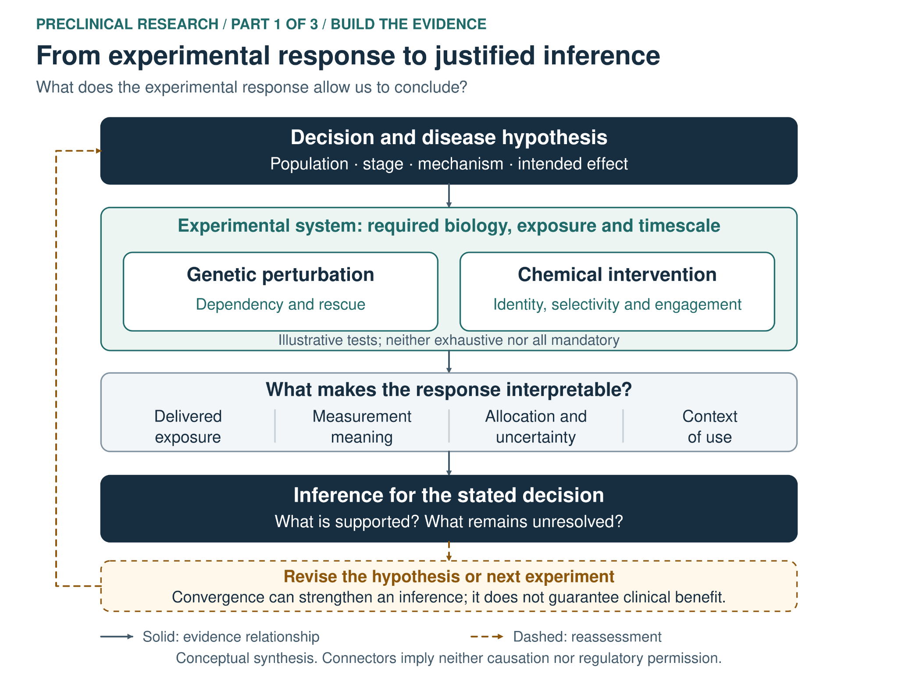

+++
title = "Preclinical Research, Part 1: Foundations, Models, and Discovery"
date = 2026-11-13T09:00:00
description = "How to connect disease hypotheses, experimental systems, and measurements to decisions that preclinical evidence can support."
+++

**Figure 1. From experimental response to justified inference.** *Complementary experiments examine different links between a disease hypothesis and an intervention response. Exposure, measurement, study design, and context of use determine what those results can establish; convergence can strengthen a specified inference without guaranteeing clinical benefit.*

A compound changes an assay signal. Has it changed the intended target, injured the cells, interfered with the detector, or altered a pathway that matters only in this experimental system? Even a reproducible result leaves these possibilities open. Building meaningful preclinical evidence means designing the next experiment to separate them.

A useful organizing question is whether the proposed mechanism has actually been tested. Morgan and colleagues examined Phase II decisions for 44 Pfizer programs and reported that, in 43%, they could not determine whether it had been adequately tested. Their Three Pillars of Survival framework connects exposure at the site of action, target binding, and functional pharmacological activity. This retrospective analysis offers a way to organize evidence; it does not provide a success probability for an individual program. (1)

This first article in the series follows the work needed to make such a test interpretable: defining a disease hypothesis, choosing perturbations and models, establishing what an assay measures, and designing comparisons that support inference. Part 2 develops exposure, safety, modality-specific development, and clinical readiness. Part 3 develops quality systems, governance, standards, and reusable knowledge. Essential exposure, welfare, measurement, and regulatory qualifications remain here because they already constrain discovery decisions.

## Start with the decision the experiment must inform

“Does it work?” is usually too broad. A decision might instead be whether reducing a particular protein changes a disease-relevant process in a specified cell state, whether a phenotype survives selective pharmacological intervention, or whether a lead warrants further development. Each requires a different comparison.

| Reader's question | Evidence to seek | What a positive result still leaves open |
| --- | --- | --- |
| Is the target relevant to disease? | Human genetic associations, tissue context, functional perturbation, and competing causal explanations | Whether a feasible intervention can reproduce the useful perturbation safely |
| Does this compound act through that target? | Chemical identity, cellular engagement, selectivity, inactive controls, and independent perturbations | Whether the target-mediated response improves disease function |
| Which experimental system should be used? | Biology and timescale required by the intended inference; components represented and omitted | Whether findings transfer to another implementation or patient population |
| Is the measured change credible? | Appropriate controls, calibration or normalization, specimen history, and reproducibility | Whether the signal represents the intended biological construct |
| Does the comparison justify advancement? | Independent allocation, relevant comparator, effect magnitude and uncertainty, exposure and mechanism evidence | Clinical benefit, a complete safety package, and regulatory acceptance |

This table is a reasoning framework, rather than a validated prediction algorithm. Its purpose is to expose the weakest evidentiary link before another experiment repeats it.

Several distinctions make the framework usable. A **model family** is an abstract type, such as an immune-humanized mouse or a liver organoid. An **implementation** specifies the actual host, donor cells, induction procedure, culture conditions, or computational configuration. A **cohort** is a particular group studied; an individual subject or donor retains its own history. Evidence about one implementation cannot automatically be assigned to an entire family.

Likewise, the protocol describes intended conduct; the execution records what happened. A generic assay is different from Tuesday's assay run. The physical measurement differs from its processing and biological interpretation. An enlarged liver, an increased liver-weight measurement, and a statement about treatment safety are related claims, each requiring its own comparison. Keeping them separate prevents a precise-looking number from acquiring a meaning it never demonstrated.

### Find evidence without counting the same experiment repeatedly

A useful search combines disease and mechanism language with the system, intervention, and endpoint of interest. Requiring the word “preclinical” can miss foundational biology, older studies, and human-derived experimental work. Bibliographic databases, full-text repositories, assay databases, omics repositories, official documents, and protocols answer complementary retrieval needs. A preprint, patent, or vendor announcement retains its source type even when it contains technically useful information.

PRISMA-S provides 16 items for reporting literature searches, including information sources, strategies, limits, dates, and deduplication. Its value here is transparency about what was actually searched. A plausible query template is not an executed search, and an access date is not evidence that methods or results were read. (2)

Deduplicating publications by DOI or PMID addresses repeated records of one paper. It does not identify multiple papers from one experiment. A pathology article, a pharmacokinetic article, and a transcriptomic article may describe the same animals. Retain publication identity and study/cohort identity separately, documenting uncertain links rather than treating every citation as independent corroboration.

Appraisal also needs separate questions. Reporting completeness, internal risk of bias, precision, and relevance are different properties. SYRCLE's animal-study tool examines domains including allocation, housing, masking, incomplete outcomes, and selective reporting. It uses an unclear judgment when reporting is insufficient to assess a domain; missing description does not prove that a safeguard was absent, but cannot establish that it occurred. (3) A correctly extracted statement can still come from a biased experiment or a source that does not support it.

## Build a target hypothesis that can fail informatively

A target hypothesis specifies the biological change sought, the disease and patient context, the direction and degree of modulation, and the response that would justify continuing. GOT-IT offers a scholarly framework for assessing target biology, intervention and model relevance. (4) A Target Product Profile adds practical aspirations such as delivery, efficacy, and safety. Neither is evidence that the intervention is already feasible.

### Human genetics narrows hypotheses; it does not prescribe a drug

A genome-wide association study, or **GWAS**, links variants to traits. The associated locus is not automatically the causal gene. Expression quantitative trait loci (**eQTLs**) and protein QTLs (**pQTLs**) connect variants to transcript or protein abundance. Colocalization asks whether molecular and disease associations plausibly share a causal signal; nearby associations can otherwise reflect linkage disequilibrium, the correlation among variants.

Mendelian randomization uses genetic variants as instruments to investigate a proposed exposure–outcome relationship. Its causal interpretation depends on instrument relevance and assumptions about confounding and alternative pathways. A variant that affects disease through several mechanisms can undermine a simple interpretation. Lifelong genetic modulation also differs from a drug's dose, tissue distribution, timing, and reversibility.

King and colleagues reanalyzed the association between genetic support and drug approval. They describe Nelson and colleagues' earlier estimate of roughly doubled development success, but their own results depend on the evidence type and causal-gene assignment: Mendelian and coding-variant support was more informative than an undifferentiated GWAS association. Some independent validation estimates were not distinguishable from no enrichment. These are historical target–indication comparisons, not a causal experiment or a probability multiplier for an individual program. (5)

PCSK9 illustrates why beneficial and adverse genetic associations deserve separate questions. Schmidt and colleagues associated variants producing lower LDL cholesterol with higher fasting glucose and type 2 diabetes risk. This Mendelian-randomization analysis concerns lifelong genetic differences; it does not assign the same risk to a drug regimen. (6) The experimental question is which consequences of genetic modulation a proposed intervention would reproduce, in which tissues and over what timescale.

Tissue and state complete the hypothesis. Bulk expression can conceal a rare cell population, and a gene dependency in a proliferating cell line may not exist in adult tissue. Single-cell and spatial measurements help locate a process, but the number of cells or features is not the number of patients or independent biological replicates. A target-prioritization score organizes evidence; without calibration against outcomes, it is not a probability of therapeutic success.

### Use genetic and chemical perturbations to test different alternatives

A successful CRISPR knockout can eliminate protein expression, including functions beyond the activity a drug would inhibit. CRISPR interference reduces expression; activation increases it. A small molecule may instead inhibit one domain partially and reversibly. Agreement across these perturbations is informative precisely because their possible artifacts differ. GOT-IT specifically cautions that genetic removal can eliminate scaffolding functions and produce a different degree or timing of modulation from a compound. (4)

A rescue experiment asks whether restoring target function reverses the perturbation phenotype. Its interpretation depends on the restored expression level, construct behavior, and controls. A useful specificity argument should explain why the rescue distinguishes the intended mechanism from alternative explanations. The same target assessment should ask whether the dependency is selective for the disease context or also present in normal cells. These are questions about mechanism and therapeutic window, not a declaration that a strong phenotype identifies a suitable drug target. (4,50)

Chemical probes add a tractable test of pharmacology. The Chemical Probes Portal's criteria for classical modulators consider biochemical potency, selectivity, cellular target engagement, and suitable controls. It recommends an inactive control and, where available, an orthogonal active probe. Those comparisons help test whether a phenotype tracks the intended interaction. (7) A probe and a development candidate serve different purposes; delivery and pharmacokinetic suitability require separate evidence.

The Portal's classical-modulator benchmarks include biochemical IC50, Ki or Kd below 100 nM, more than 30-fold selectivity within the target family, and quantified cellular target engagement below 1 µM; broader selectivity profiling is desirable. These are that resource's probe criteria, not universal candidate-advancement rules. (7) IC50 is a half-maximal inhibitory concentration under particular assay conditions; Ki is an inhibition constant and Kd a dissociation constant. Equal numerical values do not make them the same property.

### Engagement is a measurement question

The cellular thermal shift assay examines compound-associated changes in protein thermal stability. Thermal proteome profiling extends this approach across proteins using mass spectrometry. Franken and colleagues describe how the method can investigate direct and indirect drug effects. (8)

Intact-cell profiles can contain direct binding effects and indirect changes mediated by signaling, modification, or protein interactions. Comparing intact cells with extracts can help distinguish these explanations, although the environments differ. (8) Interpret a thermal shift alongside the assay conditions and complementary evidence before assigning direct target engagement.

A species comparison can expose a different missing link. Kim and colleagues report that DMXAA activates mouse STING but does not bind human STING. STING—the stimulator of interferon genes—is an innate immune-signaling protein. (9) This species-selective interaction motivates checking the relevant ortholog, the corresponding protein in another species, before inferring human engagement from a mouse tumor response.

## Make a screening signal earn its biological interpretation

Target-based screening begins with a defined molecular interaction or activity. Phenotypic screening begins with a cellular or organismal response. The first gives an earlier handle on binding or catalysis; the second can reveal responses that depend on networks or multiple targets. Neither starting point completes the mechanism argument.

### Choose the readout for the inference

| Assay family | What its signal can address | Critical alternative explanation or omitted component |
| --- | --- | --- |
| Purified enzyme assay | Substrate conversion and inhibition under defined conditions | Cell entry, metabolism, protein context, and detector interference |
| Biophysical binding, such as surface plasmon resonance (SPR) or nuclear magnetic resonance (NMR) | Interaction with a prepared target; kinetic or affinity properties where the method supports them | Functional effect in intact cells and biological specificity |
| Reporter assay | A pathway-associated transcriptional response | Reporter inhibition, cell injury, and nonspecific transcriptional effects |
| Calcium or cyclic adenosine monophosphate (cyclic-AMP) assay | A selected second-messenger response | Receptor coupling, timing, and pathway-specific activity |
| High-content imaging | Morphology, localization, and multiparameter cellular states | Segmentation errors, batch effects, and ambiguity about causal targets |

These assay families answer different questions. Changing detection chemistry can help test whether activity belongs to the biological system or to the measurement method; simply repeating the same signal does not resolve that distinction. (51)

Miniaturization makes dispensing, evaporation, plate position, and solvent conditions part of assay development. Establish acceptable performance in the format actually used. A compound prepared in neat dimethyl sulfoxide (DMSO) stock does not imply neat DMSO exposure in the final assay; report the final solvent concentration and appropriate vehicle controls.

Control separation is one component of assay quality. The conventional control-based Z′ statistic is

\[
Z'=1-\frac{3(\sigma_{+}+\sigma_{-})}{|\mu_{+}-\mu_{-}|},
\]

where μ and σ are the control means and standard deviations, measured in the same signal units. The statistic is dimensionless and combines separation with variation. Zhang and colleagues introduced the screening-window framework; the complete expression is directly available in Bar and Zweifach's analysis. (10,11)

A hypothetical example shows its meaning: controls with means 100 and 0 and standard deviations 5 each give Z′ = 1 − 30/100 = 0.70. If each standard deviation is 10, the same mean separation gives 0.40. The arithmetic shows variation's effect; it supplies no evidence that either assay models disease.

Bar and Zweifach challenge a rigid Z′ > 0.5 gate using power analysis and simulation. Assays below that threshold can still identify useful compounds with suitable hit thresholds and justified design. (11) Spatial drift, day-to-day potency reproducibility, and response to realistic controls remain separate questions. A spatial normalization procedure does not prove that drift has been removed, and Z′ does not diagnose the biological cause of a hit.

### Compare discovery routes without ranking library size as evidence quality

| Route | Useful starting situation | What an initial result represents | Next decisive check |
| --- | --- | --- | --- |
| Conventional high-throughput screening | An assay can evaluate many discrete compounds | Empirical activity in that assay | Fresh material, concentration response, interference checks, and mechanism |
| DNA-encoded library selection | A target can support pooled affinity selection | Enrichment of a tagged chemical representation | Resynthesis without the tag, background controls, binding, and function |
| Fragment screening | Sensitive methods can detect weak interactions with small molecules | A small binding starting point | Confirmed binding geometry and growth or linking supported by measurements |
| Structure-based or virtual screening | A relevant structure or model can generate testable rankings | Predicted compatibility | Experimental identity, binding, and activity |
| Phenotypic profiling | A relevant cellular state can be measured | A response pattern | Distinguish disease biology, toxicity, and causal mechanism |

These routes generate different kinds of starting evidence. Library size alone cannot establish accessible chemical diversity, hit quality, or development success. Choose the next experiment according to what the initial result actually measures.

An initial hit raises chemical and biological confirmation questions. Does its concentration response repeat with fresh, identity-checked material? Could impurities, degradation, or the detection system explain the signal? Does activity persist in an assay that uses a different measurement principle? Orthogonal assays and interference counterscreens address complementary questions: genuine bioactivity and assay interference can coexist. (51)

Structural alerts for pan-assay interference compounds (PAINS) identify concerns to investigate. They do not establish the mechanism of activity in the experiment at hand. Chemical reactivity, redox activity, fluorescence, and aggregation require different follow-up tests. Interpret the alert together with the compound, assay conditions, and experimental evidence. (52)

Cell Painting shows what a richer phenotype contributes. The original protocol uses six fluorescent dyes imaged in five channels to profile eight cellular components or compartments, followed by computational image analysis. It supports comparison of morphological profiles. (12) Similarity to a reference compound generates a mechanistic hypothesis; it does not identify a direct binding target. The assay's information content depends on image quality, segmentation, aggregation, and the biological relevance of the cells.

## Let the intervention's mechanism determine the experiment

A single equilibrium potency number cannot describe every modality. Reversible inhibitors depend on occupancy. Covalent inhibitors introduce reaction kinetics and target turnover. Degraders depend on productive recruitment and protein destruction. Gene replacement and RNA-splicing interventions change yet other steps between administration and response.

PROTACs—proteolysis-targeting chimeras—are bifunctional molecules that recruit a protein of interest to an E3 ubiquitin ligase, enabling targeted protein degradation. Gadd and colleagues report an MZ1–VHL–Brd4 bromodomain ternary structure and cooperative recognition, illustrating why binary affinity alone need not determine selectivity. (13) Han’s mathematical treatment distinguishes ternary assembly from subsequent ubiquitination and degradation. (14) A degradation readout must specify its time point and response definition; loss of the target protein is a separate endpoint from improvement in disease function.

In Han’s reversible equilibrium model, excess heterobifunctional ligand can favor separate binary complexes over a ternary complex, producing a bell-shaped concentration relationship—the hook effect. This is a conditional model result, not a prediction that every cellular degrader response must turn downward. (14)

Covalent inhibitors require attention to time-dependent inhibition. Mader and colleagues explain why a single IC50 cannot fully characterize an irreversible inhibitor: binding and inactivation kinetics both matter, and the apparent potency depends on assay conditions and measurement time. The parameters \(k_{\mathrm{inact}}\) and \(K_I\) describe different aspects of the specified kinetic model; their ratio is an efficiency measure, not a universal advancement threshold. (15)

These distinctions also explain why a gene-replacement benefit, a tissue-distribution measurement, and an RNA-splicing correction cannot be compressed into one potency rank. Delivery, expression duration, tissue access, and immune effects remain necessary questions; Part 2 develops their modality-specific consequences.

## Select a system by the biology the decision requires

A model can resemble a disease without sharing its cause. It can reproduce a mechanism without predicting a treatment effect. **Face validity** concerns observable resemblance; **construct validity** concerns the modeled disease process; **mechanistic relevance** concerns how the intervention acts; and **predictive validity** concerns performance against outcomes outside the model. These distinctions are used as a conceptual framework here, not as validated scores common to all platforms.

A useful choice often ends at a family plus a characterization plan. Choosing “organoids” or “mice” before specifying cell state, immune context, timescale, exposure, and endpoint would leave the decisive implementation choices unresolved.

### Compare what each system retains

| System | Biological leverage | Information that must accompany the result |
| --- | --- | --- |
| Cell-free preparation | Isolates selected molecular interactions | Protein preparation, cofactors, detection chemistry, and the absent cellular context |
| Immortalized cell line | Renewable material for controlled perturbation and screening | Identity, passage, contamination, lineage changes, and altered metabolism |
| Primary human cells | Native donor-associated functions | Donor provenance, handling, lot variation, viability, and functions retained in culture |
| Induced pluripotent stem cell (iPSC)-derived cells | Donor genotype and renewable differentiated lineages | Differentiation consistency, maturity, cell composition, and relevant functional characterization |
| Spheroids or organoids | Multicellular organization and selected tissue architecture | Matrix, polarity, cell populations, diffusion, necrotic cores, and donor/batch effects |
| Explant or tissue slice | Native local architecture and cell interactions | Procurement injury, ischemic history, viability window, and absent systemic support |
| Organ chip | Engineered interfaces, flow, mechanics, or sensing | Which features are present, media compatibility, device losses, delivered concentration, and scaling |
| Intact animal | Organismal interactions, behavior, circulation, and longitudinal disease | Species pharmacology, induction, background, immune experience, welfare, and patient-context mismatch |
| Computational model | Explicit integration and exploration of assumptions | Input provenance, parameter identifiability, uncertainty, calibration, validation, and applicability domain |

The table is a set of characterization questions, not a ranking of predictive performance. For organ chips, Ingber’s review provides a broader account of engineering, biological representation, and applications. (16)

Human origin establishes provenance, but maturity, population coverage, and functional relevance still need characterization. For a human-derived system, ask which cell populations and functions are represented, which components are absent, and how donor, matrix, and medium affect the intended comparison. A material described as human-derived is not necessarily chemically defined.

Chips make exposure engineering especially visible. Ask whether protein binding, material interactions, flow, and metabolism alter the concentration delivered to the cells. A change of device material needs its own recovery assessment. Connecting compartments also requires justified volume, residence-time, clearance, and medium-compatibility assumptions. Treat these as implementation-specific characterization questions. (16)

Animal complexity introduces different relevance questions. Does the species express the target in the cells that must respond? Does the induced disease persist for the intended observation period? Are age, comorbidity, immune history, and background treatment important to the clinical comparison? The value of the model depends on which of these features the decision requires.

“Humanized” also needs an object: liver cells, immune cells, or a target sequence. Specify the host, introduced human material, engraftment procedure, retained functions, and observation window. The label alone cannot establish complete immune reconstruction or suitability for a particular intervention.

### Ask which biological link a translational warning exposes

Clinical and retrospective examples can sharpen experimental questions, provided their scopes remain separate.

| Example | Observed or reported distinction | Inference to carry forward |
| --- | --- | --- |
| TGN1412 | Eastwood and colleagues identified species differences in CD28 expression on CD4+ effector-memory T cells as an explanation for the unexpected human cytokine response. (17) | Cross-reactive binding does not establish the same responding cell population. This is an explanation specific to the studied mechanism, not a measure of all antibody-model accuracy. |
| Fialuridine | In Xu and colleagues' retrospective study, humanized-liver TK-NOG mice developed dose-dependent injury while controls did not. The clinical background was 7 liver-failure cases among 15 participants, including 5 deaths and 2 transplants. At 2.5 mg/kg/day for 14 days, the mouse comparison used 6 animals per group and detected liver-injury signals. (18) | Human hepatocytes can reveal a species-dependent liability, but that dose was still approximately ten times the human dose; dose ratio is not exposure equivalence or universal humanized-model validation. |
| Atabecestat | The truncated clinical trial included 557 participants and reported dose-related cognitive worsening and neuropsychiatric adverse events. Here “preclinical Alzheimer disease” describes a human disease stage, not an animal experiment. (19) | A biomarker-directed mechanism does not establish benefit. The trial result alone does not resolve the mechanism of harm. |
| Iniparib | Liu and colleagues' abstract reports that neither iniparib nor its nitroso metabolite behaved as a poly(ADP-ribose) polymerase (PARP) inhibitor in their enzyme and cellular assays; they found nonspecific protein adducts. (20) | Phenotypic activity and the proposed target mechanism require independent tests. No clinical effect estimate is inferred. |
| BIA 10-2474 | Activity-based proteomics found off-target lipase inhibition and altered lipid networks in human cortical neurons. The investigators explicitly stated that the clinical neurotoxicity's cause was unknown. (21) | These experiments support an off-target hypothesis; they do not establish that this mechanism caused the neurological harm. |

These cases motivate targeted checks. They do not share a denominator, establish a common failure cause, or yield an animal-versus-human-platform ranking.

### A benchmark is useful only with its denominator and analysis

The Ewart study evaluated 27 drugs overall. Its protein-binding-corrected two-donor Table 6 analysis contained 18: 13 true positives, 2 false negatives, 3 true negatives, and no false positives. Sensitivity was 13/15, or 87% rounded, with a reported 95% confidence interval of 61.5–96.0%; specificity was 3/3, or 100%. The exposure-margin threshold of 375 was selected to maximize sensitivity while avoiding false positives. (22)

The uncorrected two-donor sensitivity was 12/15, or 80%. The comparison with spheroids used previously published data, and the authors disclosed commercial interests. These results do not establish performance across all compounds or uses. The January 2023 correction changed Table 5’s spheroid specificity from 100% to 67% and corrected an abstract typo; the February correction replaced Table 3, which had duplicated Table 2. (22–24) These corrections concern distinct analyses and must accompany reuse of the paper.

## Use disease examples to test the selection logic

The same model-selection mistake recurs across indications: a convenient measurable outcome substitutes for the biological process the decision requires. The examples below preserve useful distinctions without implying a comprehensive disease atlas.

| Intended inference | Model or readout comparison | What must be resolved before a treatment claim |
| --- | --- | --- |
| Persistent pulmonary fibrosis | Single versus repetitive bleomycin injury (29) | Established fibrosis versus acute injury; persistence, treatment timing, mortality, and masking |
| Relief of neuropathic pain | Evoked withdrawal versus spontaneous or affective measures (25) | Motor effects, sedation, stimulus sensitivity, and the dimensions of pain represented |
| Cardiac disease modification | Multi-hit heart failure with preserved ejection fraction (HFpEF) models (26) | Which metabolic, hypertensive, age, sex, and substrain features are represented; preserved ejection fraction alone is incomplete |
| Sepsis treatment | Infection, dysregulated host response, and life-threatening organ dysfunction, as specified by MQTiPSS (27) | Whether the model meets the disease definition and how treatment timing, resuscitation, and antimicrobial therapy affect relevance |
| Aging intervention | Survival versus functional healthspan outcomes (28) | Sex, dose, genetic background, site, disease burden, and the survival or functional quantity being estimated |

These examples illustrate selection questions, not complete protocols or comparative rankings. MQTiPSS stands for Minimum Quality Threshold in Pre-clinical Sepsis Studies. A model family should be selected only after its actual implementation and relevance to the intended endpoint have been assessed.

A hypothetical antifibrotic selection illustrates the sequence. If the decision concerns established persistent scar, treatment concurrent with an acute insult tests prevention or early injury modification. A later intervention needs evidence that fibrosis is present when treatment begins. Histology, extracellular-matrix measures, physiology, and mortality answer different questions. Repetitive injury might provide persistence while introducing cumulative injury and welfare concerns. The appropriate choice is the implementation that tests the intended stage with interpretable exposure and outcomes; complexity alone supplies no answer.

Protocol details can change the inference even within a named model family. For a repetitive-injury model, establish the exact dosing interval and observation period from the methods. For a multi-hit cardiac model, identify which metabolic and hypertensive components were used and whether the reported sex and substrain match the intended study. (26,29) A model name is not an executable protocol.

The rapamycin example separates survival from broader claims about aging. Strong and colleagues studied late-life treatment schedules in genetically heterogeneous UM-HET3 mice and reported sex- and schedule-dependent survival effects. The authors also discuss a chow-supplier difference that complicated interpretation. (28) A survival result should retain its treatment schedule, population, and analysis; it cannot be relabeled an increase in healthy lifespan without appropriate functional evidence.

A porcine liver-transplantation study illustrates another endpoint distinction. Riveros and colleagues compared normothermic machine perfusion with static cold storage, reporting differences in bile production, lactate, and post-transplant enzyme release. (30) Those endpoints address different aspects of graft physiology and injury; they do not by themselves establish clinical superiority.

## Design the comparison at the level where treatment is allocated

A well-chosen biological system can still produce an uninterpretable experiment. Specify the intended effect before choosing an analysis: treatment and comparator, population or model implementation, endpoint and time, summary measure, and handling of events that change whether the outcome exists or can be observed. This borrows the logic of an estimand—a precisely specified treatment effect—without claiming that a clinical-trial framework is a universal preclinical requirement. ICH E9(R1), in its May 2021 FDA implementation, supports this clinical distinction between the question, estimand and analysis. (31)

The independent **experimental unit** is determined by allocation and application of treatment. An **observational unit** supplies a measurement; a **biological unit of interest** is what the inference concerns. These can differ. Lazic and colleagues emphasize independent assignment, independent treatment application, and lack of relevant influence between units when judging genuine replication. (32)

In a hypothetical design with two treated and two control cages, each containing five mice and receiving one shared water treatment, there are four cage-level treatment allocations, not twenty independent allocations. More measurements per mouse characterize within-cage variation; they do not create more treatment replications. If drugs are independently allocated and administered to animals under a different design, the unit can change. The example depends on how the experiment is conducted, rather than on a permanent rule that cage or mouse is always correct.

Blocking can balance a known source of variation such as donor, litter or day. NC3Rs guidance recommends randomization within blocks and accounting for the block in analysis; it also warns that an uninformative block can consume degrees of freedom. (33) Factorial designs address interactions as well as main effects. Split-plot designs allocate factors at different levels, such as an incubator-level environment and drug conditions within plates. They make allocation visible without prescribing an analysis for an unspecified dataset.

Randomization, concealment, and masking address different opportunities for bias. Randomization determines allocation; concealment protects entry decisions from knowledge of the next assignment; masking limits knowledge during conduct, assessment, or analysis. Reporting their actual implementation makes a study assessable. ARRIVE 2.0 organizes 21 reporting items into the Essential 10 and an additional Recommended Set. It supports transparent appraisal rather than certifying that a reported experiment is unbiased. (34)

PREPARE addresses planning through 15 topics, including dialogue with facilities, competence, husbandry, procedures, and humane killing and necropsy. Its prospective role complements reporting after conduct. (35) A plan, completed checklist, or software assistant cannot substitute for evidence that the planned comparison was carried out.

### Anticipate loss of observations without changing the question after seeing results

Death, humane euthanasia, severe impairment, contamination, or chip failure can change both observation and interpretation. Removing affected units can make the remaining group look healthier or more effective than the allocated group. Carrying the last observation forward can falsely freeze a progressive process.

| Intended approach to a post-treatment event | What changes in the question | Limitation to retain |
| --- | --- | --- |
| Include the event in the endpoint | Failure, rescue, or death becomes part of the outcome | Components must have a defined interpretation |
| Estimate a hypothetical outcome without the event | The analysis targets a counterfactual scenario | Requires assumptions about unobserved outcomes |
| Analyze the observed longitudinal process with an event model | The relationship between trajectory and attrition is modeled | Model structure and identifiability remain consequential |
| Restrict to a principal stratum | The target is units that would avoid the event under either treatment | This is not simply the observed survivors; membership is counterfactual |

ICH E9(R1) provides the clinical basis for composite, hypothetical, and principal-stratum strategies. A principal stratum is not simply the observed survivor group. An outcome after death may be undefined rather than merely missing. (31) The table applies these distinctions as planning questions; a joint longitudinal–event model requires additional model-specific justification.

The analysis should state what it assumes about missing observations and why. Consider whether the conclusion would change under plausible alternative outcomes for units with missing data. An analysis that accepts incomplete records does not, by itself, resolve the reason those records are incomplete. (31)

Sample-size justification begins with the effect that would matter, expected variation, independent units, design, and analysis. A conventional target such as 80% power is an input, not an assurance of scientific value. Smalheiser and colleagues examined mouse forced-swim assays with known antidepressant positive controls and reported large standardized effects. Their sample-size conclusions apply to that setting, not to all preclinical experiments or an untested agent. (36)

Analysis and plotting should retain the hierarchy of the experiment. Additional cells measured within a culture do not create additional independent treatment allocations. SuperPlots display individual observations together with replicate-level summaries so readers can see both within-experiment variation and reproducibility across experiments. (32,37) The design must still establish which units support the inference.

## Treat welfare and measurement as part of the experimental system

Welfare and husbandry belong in the experimental plan because they shape both the animals’ experience and the conditions under which the comparison is made. Document handling, housing, care, and humane endpoints at the level needed to interpret the study. PREPARE provides a framework for planning these elements with the facility and responsible personnel. (35)

Replacement, reduction, and refinement must be considered alongside the scientific objective. Fewer animals do not represent an informative reduction if the comparison cannot resolve its intended effect. Refinement includes necessary care and prospectively defined humane endpoints. Rescue treatment can itself affect an endpoint—for example, anti-inflammatory rescue in an inflammatory-disease study—so its role belongs in the study question and event-handling plan. It should not be withheld to preserve an assay signal. PREPARE supports prospective attention to welfare and humane endpoints. (35)

Specimen handling requires the same prospective attention. Retain subject or donor identity, collection and processing times, temperature, storage and freeze–thaw history. M10 specifically addresses matrix stability under actual handling conditions and possible metabolite back-conversion during analysis, which can affect reported parent concentration. (38) These are method-specific characterization questions, not evidence that every analyte is unstable.

### Follow the transformation from signal to biological claim

| Level | Example | Question to preserve |
| --- | --- | --- |
| Raw signal | Detector counts, fluorescence image, mass spectrum | What did the instrument record? |
| Processed output | Integrated peak, aligned reads, segmented cell mask | Which transformations and quality decisions were applied? |
| Derived quantity | Concentration, fold change, uptake value | Which calibration, normalization, or model produced the number? |
| Biological interpretation | Target engagement, injury, response | What evidence connects the quantity to that construct? |
| Decision | Continue, redesign, or stop | Is the inference adequate for the stated use? |

A result below the lower limit of quantification should retain its flag and the relevant limit rather than become an observed zero. Likewise, retain the distinction between a tentative molecular assignment and a confirmed identity. In high-throughput data, batch structure creates another interpretive risk: Leek and colleagues explain how processing all cases and controls in different batches can make technical and biological differences inseparable. (39)

The FDA's November 2022 M10 guidance replaced the 2019 draft. It concerns bioanalytical drug/metabolite measurements supporting regulatory decisions and permits scientifically justified alternatives within applicable law; it is not a universal rule for discovery readouts. (38)

An exact denominator matters in M10's incurred-sample reanalysis: the percentage difference between repeat and original concentrations uses their mean, not the original value alone. Acceptance limits differ between chromatographic and ligand-binding methods. (38) Detailed validation belongs with the analytical method and development program.

### Do not let a biomarker become a clinical endpoint by implication

A pharmacodynamic biomarker indicates a biological response to an intervention. A prognostic biomarker concerns the likelihood of an outcome, while a predictive biomarker identifies differences in the likelihood of benefit or harm from an intervention. A surrogate endpoint substitutes for a direct clinical outcome and needs evidence appropriate to that use. The FDA–NIH BEST resource defines these categories. (40) FDA’s qualification framework likewise ties a biomarker to a stated context of use; a biomarker result is not itself an assessment of how a person feels, functions, or survives. (41)

Qualification applies to a marker in a defined context. FDA’s April 2008 letter includes urinary kidney injury molecule-1 (KIM-1) among markers for voluntary complementary assessment of acute drug-induced nephrotoxicity in rats. (42) Its November 2025 determination qualifies serum glutamate dehydrogenase (GLDH), alongside standard hepatic markers, for a specified clinical-trial setting involving muscle-related transaminase elevation; the determination notes that pre-existing liver disease was not studied. (43) Neither decision establishes universal biomarker superiority or extends qualification to other markers by association.

Spatial and image-derived data require the same separation between measurement and interpretation. Ask how segmentation, overlapping structures, staining, and classification affect the result. A precise coordinate or automated label still needs evidence that it represents the intended biological object. High-content screening guidance describes interference and artifacts that can complicate such measurements. (53)

## Distinguish scientific usefulness from official acceptance

Analytical performance asks whether a measurement is fit for its intended task. Biological validation asks whether the system represents the process or predicts an outcome of interest. Transferability asks whether performance survives movement between settings. Qualification or acceptance asks a specific authority to recognize a tool or evidence for a defined use. These statuses should be recorded separately.

OECD's GIVIMP addresses in vitro method practices for regulatory human-safety assessment. The original 2018 document is Series on Testing and Assessment No. 286. (44) A second edition, No. 421, was published in December 2025; its official description covers roles, quality, facilities, materials, test systems, controls, procedures, performance, reporting and records, and identifies additional human-serum ethics content. (45) This is guidance with a stated scope, not evidence that every discovery assay is legally subject to a universal GIVIMP mandate.

FDA’s ISTAND submission process distinguishes a Letter of Intent, Qualification Plan, and Full Qualification Package. Qualification concerns a specified context of use. (46) FDA’s September 2024 Liver-Chip announcement described acceptance of a Letter of Intent, an early stage in that process. (47) When reusing an announcement, distinguish its dated status from a later qualification decision and from approval of an individual product.

The broader choice between animal and non-animal evidence depends on the product and question. FDA’s public explanation describes in vitro, in silico, and in vivo testing and consultation with the agency. It supports neither a blanket animal-testing ban nor automatic sufficiency of a non-animal platform. (48) Scientific relevance and regulatory acceptability both need a defined context.

Acceptance in one jurisdiction, conformity to hardware dimensions, and scientific prediction are different propositions. Likewise, chemical-hazard test guidelines do not automatically establish the adequacy of a therapeutic efficacy model. Part 3 develops the official-version and applicability questions; Part 2 develops the candidate-specific evidence package.

## Keep the inference reusable

A reusable evidence record connects the result to its source and context: model implementation, intervention, dose or exposure, comparator, endpoint, time, independent units, uncertainty, exclusions, and limitations. Distinguish an observed result from an interpretation, prediction, and proposed experiment. Record missing information with a reason rather than filling it from a nearby table or a familiar convention.

An ontology specifies kinds of entities and their relationships; a terminology organizes labels; an exchange format packages data. They can cooperate without becoming interchangeable. PROV-O, the W3C provenance ontology, supplies Entity, Activity, and Agent and relationships linking an output to the activity that generated it and the agent to which it is attributed. (49) Those relationships help make an inference inspectable. They do not verify the experiment or cause the encoded claim to become true.

A useful closing worksheet is therefore a compact test of the next decision:

| Field | Write a specific answer |
| --- | --- |
| Decision | What will change if this experiment is positive, negative, or inconclusive? |
| Disease hypothesis | Which population, stage, tissue, and mechanism are relevant? |
| Perturbation | What is changed, to what degree, for how long, and by which modality? |
| System | Which implementation contains the required biology, and what does it omit? |
| Exposure and engagement | What measurements establish access and the intended interaction? |
| Comparison and replication | What is allocated independently, against which control, and across which relevant conditions? |
| Endpoint | What is directly measured, and what further inference connects it to the decision? |
| Events and uncertainty | How will rescue, failure, death, missingness, and bounds affect the intended effect? |
| Alternative explanation | Which result would distinguish the intended mechanism from interference, toxicity, or model-specific biology? |
| Source and applicability | Which sources support the claim, and where does applicability remain uncertain? |

The next experiment becomes useful when its possible outcomes separate meaningful alternatives. Sometimes it supports advancement. Sometimes it identifies an exposure problem, a measurement problem, or a hypothesis that needs to change. Preserving those differences makes a negative or inconclusive result informative and keeps a favorable result within the inference it earned.

## Scope and interpretation

This narrative guide is a framework for selecting and interpreting experiments, not a systematic review, exhaustive model catalog, or comparative prediction benchmark. Tables and hypothetical examples organize questions; they do not constitute validated scores or operating protocols. Study-specific results retain their populations, denominators, and limitations. Regulatory examples refer to the cited documents and their stated scope.

## Further Reading

- Morgan et al., 2012. [Can the flow of medicines be improved?](https://doi.org/10.1016/j.drudis.2011.12.020) The original Three Pillars framework for connecting exposure, target binding, and pharmacological activity.
- Rethlefsen et al., 2021. [PRISMA-S](https://doi.org/10.1186/s13643-020-01542-z). A practical framework for making search methods inspectable.
- Hooijmans et al., 2014. [SYRCLE's risk of bias tool](https://doi.org/10.1186/1471-2288-14-43). Separates bias appraisal from completeness and generalizability.
- Arrowsmith et al., 2015. [The promise and peril of chemical probes](https://doi.org/10.1038/nchembio.1867). Discusses the selection and interpretation of chemical probes. (50)
- Bar and Zweifach, 2020. [Z′ does not need to be >0.5](https://doi.org/10.1177/2472555220942764). Examines the assumptions behind a familiar assay gate.
- Bray et al., 2016. [Cell Painting](https://doi.org/10.1038/nprot.2016.105). A protocol linking image acquisition and morphological profiling.
- Ewart et al., 2022. [Performance assessment of a human Liver-Chip](https://doi.org/10.1038/s43856-022-00209-1). A worked example of why donor coverage, denominators, and analytical choices matter.
- Lazic et al., 2018. [What exactly is ‘N’?](https://doi.org/10.1371/journal.pbio.2005282). Explains how allocation and treatment application determine replication.
- Percie du Sert et al., 2020. [ARRIVE 2.0](https://doi.org/10.1371/journal.pbio.3000410). Specifies information needed to appraise animal experiments.
- Smith et al., 2018. [PREPARE](https://doi.org/10.1177/0023677217724823). Connects experimental planning with facility, welfare, and execution questions.

## References

1. Morgan P, Van Der Graaf PH, Arrowsmith J, Feltner DE, Drummond KS, Wegner CD, et al. Can the flow of medicines be improved? Fundamental pharmacokinetic and pharmacological principles toward improving Phase II survival. Drug Discov Today. 2012;17(9-10):419-24. doi: [10.1016/j.drudis.2011.12.020](https://doi.org/10.1016/j.drudis.2011.12.020).
2. Rethlefsen ML, Kirtley S, Waffenschmidt S, Ayala AP, Moher D, Page MJ, et al. PRISMA-S: an extension to the PRISMA Statement for Reporting Literature Searches in Systematic Reviews. Syst Rev. 2021;10:39. doi: [10.1186/s13643-020-01542-z](https://doi.org/10.1186/s13643-020-01542-z).
3. Hooijmans CR, Rovers MM, de Vries RBM, Leenaars M, Ritskes-Hoitinga M, Langendam MW. SYRCLE’s risk of bias tool for animal studies. BMC Med Res Methodol. 2014;14:43. doi: [10.1186/1471-2288-14-43](https://doi.org/10.1186/1471-2288-14-43).
4. Emmerich CH, Martinez Gamboa L, Hofmann MCJ, Bonin-Andresen M, Arbach O, Schendel P, et al. Improving target assessment in biomedical research: the GOT-IT recommendations. Nat Rev Drug Discov. 2021;20(1):64-81. doi: [10.1038/s41573-020-0087-3](https://doi.org/10.1038/s41573-020-0087-3).
5. King EA, Davis JW, Degner JF. Are drug targets with genetic support twice as likely to be approved? Revised estimates of the impact of genetic support for drug mechanisms on the probability of drug approval. PLoS Genet. 2019;15(12):e1008489. doi: [10.1371/journal.pgen.1008489](https://doi.org/10.1371/journal.pgen.1008489).
6. Schmidt AF, Swerdlow DI, Holmes MV, Patel RS, Fairhurst-Hunter Z, Carty CL, et al. PCSK9 genetic variants and risk of type 2 diabetes: a mendelian randomisation study. Lancet Diabetes Endocrinol. 2017;5(2):97-105. doi: [10.1016/S2213-8587(16)30396-5](https://doi.org/10.1016/S2213-8587(16)30396-5).
7. Chemical Probes Portal. Classical modulators [Internet]. [cited 2026 Oct 28]. Available from: [Chemical Probes Portal](https://www.chemicalprobes.org/info/classical-modulators).
8. Franken H, Mathieson T, Childs D, Sweetman GMA, Werner T, Tögel I, et al. Thermal proteome profiling for unbiased identification of direct and indirect drug targets using multiplexed quantitative mass spectrometry. Nat Protoc. 2015;10(10):1567-93. doi: [10.1038/nprot.2015.101](https://doi.org/10.1038/nprot.2015.101).
9. Kim S, Li L, Maliga Z, Yin Q, Wu H, Mitchison TJ. Anticancer flavonoids are mouse-selective STING agonists. ACS Chem Biol. 2013;8(7):1396-401. doi: [10.1021/cb400264n](https://doi.org/10.1021/cb400264n).
10. Zhang JH, Chung TDY, Oldenburg KR. A simple statistical parameter for use in evaluation and validation of high throughput screening assays. J Biomol Screen. 1999;4(2):67-73. doi: [10.1177/108705719900400206](https://doi.org/10.1177/108705719900400206).
11. Bar H, Zweifach A. Z′ does not need to be >0.5. SLAS Discov. 2020;25(9):1000-8. doi: [10.1177/2472555220942764](https://doi.org/10.1177/2472555220942764).
12. Bray MA, Singh S, Han H, Davis CT, Borgeson B, Hartland C, et al. Cell Painting, a high-content image-based assay for morphological profiling using multiplexed fluorescent dyes. Nat Protoc. 2016;11(9):1757-74. doi: [10.1038/nprot.2016.105](https://doi.org/10.1038/nprot.2016.105).
13. Gadd MS, Testa A, Lucas X, Chan KH, Chen W, Lamont DJ, et al. Structural basis of PROTAC cooperative recognition for selective protein degradation. Nat Chem Biol. 2017;13(5):514-21. doi: [10.1038/nchembio.2329](https://doi.org/10.1038/nchembio.2329).
14. Han B. A suite of mathematical solutions to describe ternary complex formation and their application to targeted protein degradation by heterobifunctional ligands. J Biol Chem. 2020;295(45):15280-91. doi: [10.1074/jbc.RA120.014715](https://doi.org/10.1074/jbc.RA120.014715).
15. Mader LK, Borean JE, Keillor JW. A practical guide for the assay-dependent characterisation of irreversible inhibitors. RSC Med Chem. 2025;16(1):63-76. doi: [10.1039/D4MD00707G](https://doi.org/10.1039/D4MD00707G).
16. Ingber DE. Human organs-on-chips for disease modelling, drug development and personalized medicine. Nat Rev Genet. 2022;23(8):467-91. doi: [10.1038/s41576-022-00466-9](https://doi.org/10.1038/s41576-022-00466-9).
17. Eastwood D, Findlay L, Poole S, Bird C, Wadhwa M, Moore M, et al. Monoclonal antibody TGN1412 trial failure explained by species differences in CD28 expression on CD4+ effector memory T-cells. Br J Pharmacol. 2010;161(3):512-26. doi: [10.1111/j.1476-5381.2010.00922.x](https://doi.org/10.1111/j.1476-5381.2010.00922.x).
18. Xu D, Nishimura T, Nishimura S, Zhang H, Zheng M, Guo YY, et al. Fialuridine induces acute liver failure in chimeric TK-NOG mice: a model for detecting hepatic drug toxicity prior to human testing. PLoS Med. 2014;11(4):e1001628. doi: [10.1371/journal.pmed.1001628](https://doi.org/10.1371/journal.pmed.1001628).
19. Sperling R, Henley D, Aisen PS, Raman R, Donohue MC, Ernstrom K, et al. Findings of efficacy, safety, and biomarker outcomes of atabecestat in preclinical Alzheimer disease: a truncated randomized phase 2b/3 clinical trial. JAMA Neurol. 2021;78(3):293-301. doi: [10.1001/jamaneurol.2020.4857](https://doi.org/10.1001/jamaneurol.2020.4857).
20. Liu X, Shi Y, Maag DX, Palma JP, Patterson MJ, Ellis PA, et al. Iniparib nonselectively modifies cysteine-containing proteins in tumor cells and is not a bona fide PARP inhibitor. Clin Cancer Res. 2012;18(2):510-23. doi: [10.1158/1078-0432.CCR-11-1973](https://doi.org/10.1158/1078-0432.CCR-11-1973).
21. van Esbroeck ACM, Janssen APA, Cognetta AB 3rd, Ogasawara D, Shpak G, van der Kroeg M, et al. Activity-based protein profiling reveals off-target proteins of the FAAH inhibitor BIA 10-2474. Science. 2017;356(6342):1084-7. doi: [10.1126/science.aaf7497](https://doi.org/10.1126/science.aaf7497).
22. Ewart L, Apostolou A, Briggs SA, Carman CV, Chaff JT, Heng AR, et al. Performance assessment and economic analysis of a human Liver-Chip for predictive toxicology. Commun Med (Lond). 2022;2:154. doi: [10.1038/s43856-022-00209-1](https://doi.org/10.1038/s43856-022-00209-1).
23. Ewart L, Apostolou A, Briggs SA, Carman CV, Chaff JT, Heng AR, et al. Author Correction: Performance assessment and economic analysis of a human Liver-Chip for predictive toxicology. Commun Med (Lond). 2023;3:7. doi: [10.1038/s43856-023-00235-7](https://doi.org/10.1038/s43856-023-00235-7).
24. Ewart L, Apostolou A, Briggs SA, Carman CV, Chaff JT, Heng AR, et al. Author Correction: Performance assessment and economic analysis of a human Liver-Chip for predictive toxicology. Commun Med (Lond). 2023;3:16. doi: [10.1038/s43856-023-00249-1](https://doi.org/10.1038/s43856-023-00249-1).
25. Fisher AS, Lanigan MT, Upton N, Lione LA. Preclinical neuropathic pain assessment; the importance of translatability and bidirectional research. Front Pharmacol. 2021;11:614990. doi: [10.3389/fphar.2020.614990](https://doi.org/10.3389/fphar.2020.614990).
26. McIntosh B, Elbassioni AAM, Raheem A, MacDonald EA, Nicklin SA, Koay YC, et al. Optimized murine HFpEF models for translational preclinical studies. ESC Heart Fail. 2026;13(2):xvag072. doi: [10.1093/eschf/xvag072](https://doi.org/10.1093/eschf/xvag072).
27. Osuchowski MF, Ayala A, Bahrami S, Bauer M, Boros M, Cavaillon JM, et al. Minimum quality threshold in pre-clinical sepsis studies (MQTiPSS): an international expert consensus initiative for improvement of animal modeling in sepsis. Intensive Care Med Exp. 2018;6:26. doi: [10.1186/s40635-018-0189-y](https://doi.org/10.1186/s40635-018-0189-y).
28. Strong R, Miller RA, Bogue M, Fernandez E, Javors MA, Libert S, et al. Rapamycin-mediated mouse lifespan extension: late-life dosage regimes with sex-specific effects. Aging Cell. 2020;19(11):e13269. doi: [10.1111/acel.13269](https://doi.org/10.1111/acel.13269).
29. Degryse AL, Tanjore H, Xu XC, Polosukhin VV, Jones BR, McMahon FB, et al. Repetitive intratracheal bleomycin models several features of idiopathic pulmonary fibrosis. Am J Physiol Lung Cell Mol Physiol. 2010;299(4):L442-52. doi: [10.1152/ajplung.00026.2010](https://doi.org/10.1152/ajplung.00026.2010).
30. Riveros S, Marino C, Ochoa G, Soto D, Alegría L, Zenteno MJ, et al. Customized normothermic machine perfusion decreases ischemia-reperfusion injury compared with static cold storage in a porcine model of liver transplantation. Artif Organs. 2023;47(1):148-59. doi: [10.1111/aor.14390](https://doi.org/10.1111/aor.14390).
31. Food and Drug Administration. E9(R1) statistical principles for clinical trials: addendum: estimands and sensitivity analysis in clinical trials: guidance for industry [Internet]. Silver Spring (MD): FDA; 2021 May [cited 2026 Oct 28]. Available from: [FDA](https://www.fda.gov/media/148473/download).
32. Lazic SE, Clarke-Williams CJ, Munafò MR. What exactly is ‘N’ in cell culture and animal experiments? PLoS Biol. 2018;16(4):e2005282. doi: [10.1371/journal.pbio.2005282](https://doi.org/10.1371/journal.pbio.2005282).
33. National Centre for the Replacement, Refinement and Reduction of Animals in Research. Allocation. Experimental Design Assistant [Internet]. [cited 2026 Oct 28]. Available from: [NC3Rs](https://eda.nc3rs.org.uk/experimental-design-allocation).
34. Percie du Sert N, Hurst V, Ahluwalia A, Alam S, Avey MT, Baker M, et al. The ARRIVE guidelines 2.0: updated guidelines for reporting animal research. PLoS Biol. 2020;18(7):e3000410. doi: [10.1371/journal.pbio.3000410](https://doi.org/10.1371/journal.pbio.3000410).
35. Smith AJ, Clutton RE, Lilley E, Hansen KEA, Brattelid T. PREPARE: guidelines for planning animal research and testing. Lab Anim. 2018;52(2):135-41. doi: [10.1177/0023677217724823](https://doi.org/10.1177/0023677217724823).
36. Smalheiser NR, Graetz EE, Yu Z, Wang J. Effect size, sample size and power of forced swim test assays in mice: guidelines for investigators to optimize reproducibility. PLoS One. 2021;16(2):e0243668. doi: [10.1371/journal.pone.0243668](https://doi.org/10.1371/journal.pone.0243668).
37. Lord SJ, Velle KB, Mullins RD, Fritz-Laylin LK. SuperPlots: communicating reproducibility and variability in cell biology. J Cell Biol. 2020;219(6):e202001064. doi: [10.1083/jcb.202001064](https://doi.org/10.1083/jcb.202001064).
38. Food and Drug Administration. M10 bioanalytical method validation and study sample analysis: guidance for industry [Internet]. Silver Spring (MD): FDA; 2022 Nov [cited 2026 Oct 28]. Available from: [FDA](https://www.fda.gov/media/162903/download).
39. Leek JT, Scharpf RB, Corrada Bravo H, Simcha D, Langmead B, Johnson WE, et al. Tackling the widespread and critical impact of batch effects in high-throughput data. Nat Rev Genet. 2010;11(10):733-9. doi: [10.1038/nrg2825](https://doi.org/10.1038/nrg2825).
40. FDA-NIH Biomarker Working Group. BEST (Biomarkers, EndpointS, and other Tools) resource [Internet]. Silver Spring (MD): Food and Drug Administration; Bethesda (MD): National Institutes of Health; 2016– [cited 2026 Oct 28]. Available from: [NCBI Bookshelf](https://www.ncbi.nlm.nih.gov/books/NBK326791/).
41. Food and Drug Administration. About biomarkers and qualification [Internet]. Silver Spring (MD): FDA; [cited 2026 Oct 28]. Available from: [FDA](https://www.fda.gov/drugs/biomarker-qualification-program/about-biomarkers-and-qualification).
42. Food and Drug Administration. Review submission of the qualification of seven biomarkers of drug-induced nephrotoxicity in rats [Internet]. Silver Spring (MD): FDA; 2008 Apr 14 [cited 2026 Oct 28]. Available from: [FDA letter, recipient-hosted copy](https://c-path.org/wp-content/uploads/2014/09/PSTC-NWG-20080414-FDA-FinalConclusion.pdf).
43. Food and Drug Administration. Drug development tool qualification determination: DDT-BMQ-000050, serum glutamate dehydrogenase [Internet]. Silver Spring (MD): FDA; 2025 Nov 12 [cited 2026 Oct 28]. Available from: [FDA letter, recipient-hosted copy](https://media.c-path.org/wp-content/uploads/20251114184437/Qualification-Determination-Letter_DDT-BMQ-000050-FQP-2-VS.pdf).
44. Organisation for Economic Co-operation and Development. Guidance document on good in vitro method practices (GIVIMP). Paris: OECD Publishing; 2018. OECD Series on Testing and Assessment; No. 286. doi: [10.1787/9789264304796-en](https://doi.org/10.1787/9789264304796-en).
45. Organisation for Economic Co-operation and Development. Guidance document on good in vitro method practices (GIVIMP), second edition. Paris: OECD Publishing; 2025. OECD Series on Testing and Assessment; No. 421. doi: [10.1787/5ba6777b-en](https://doi.org/10.1787/5ba6777b-en).
46. Food and Drug Administration. Innovative Science and Technology Approaches for New Drugs (ISTAND) Program submission process [Internet]. Silver Spring (MD): FDA; [cited 2026 Oct 28]. Available from: [FDA](https://www.fda.gov/drugs/innovative-science-and-technology-approaches-new-drugs-istand-program/innovative-science-and-technology-approaches-new-drugs-istand-program-submission-process).
47. Food and Drug Administration. FDA’s ISTAND Pilot Program accepts a submission of first organ-on-a-chip technology designed to predict human drug-induced liver injury (DILI) [Internet]. Silver Spring (MD): FDA; 2024 Sep 24 [cited 2026 Oct 28]. Available from: [FDA](https://www.fda.gov/drugs/drug-alerts-and-statements/fdas-istand-pilot-program-accepts-submission-first-organ-chip-technology-designed-predict-human-drug).
48. Food and Drug Administration. Animal welfare, testing and research of FDA-regulated products [Internet]. Silver Spring (MD): FDA; [cited 2026 Oct 28]. Available from: [FDA](https://www.fda.gov/consumers/consumer-updates/animal-welfare-testing-and-research-fda-regulated-products).
49. Lebo T, Sahoo S, McGuinness D, editors. PROV-O: the PROV ontology [Internet]. W3C Recommendation; 2013 Apr 30 [cited 2026 Oct 28]. Available from: [W3C](https://www.w3.org/TR/2013/REC-prov-o-20130430/).
50. Arrowsmith CH, Audia JE, Austin C, Baell J, Bennett J, Blagg J, et al. The promise and peril of chemical probes. Nat Chem Biol. 2015;11(8):536-41. doi: [10.1038/nchembio.1867](https://doi.org/10.1038/nchembio.1867).

51. Compound-mediated assay interferences in homogeneous proximity assays. In: Assay Guidance Manual [Internet]. Bethesda (MD): National Center for Advancing Translational Sciences; [cited 2026 Nov 11]. Available from: [NCBI Bookshelf](https://www.ncbi.nlm.nih.gov/books/NBK553584/).
52. Assay interference by chemical reactivity. In: Assay Guidance Manual [Internet]. Bethesda (MD): National Center for Advancing Translational Sciences; [cited 2026 Nov 11]. Available from: [NCBI Bookshelf](https://www.ncbi.nlm.nih.gov/books/NBK326709/).
53. Interference and artifacts in high-content screening. In: Assay Guidance Manual [Internet]. Bethesda (MD): National Center for Advancing Translational Sciences; [cited 2026 Nov 11]. Available from: [NCBI Bookshelf](https://www.ncbi.nlm.nih.gov/books/NBK615088/).
