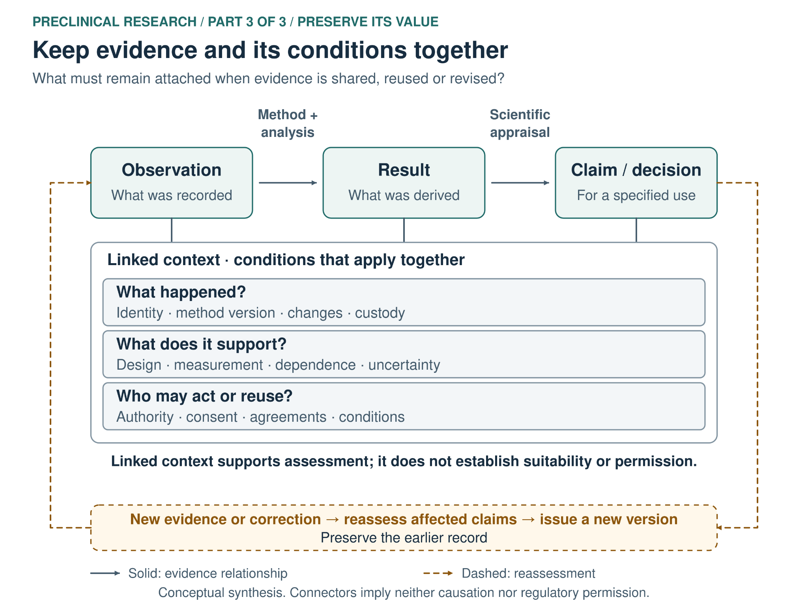

+++
title = "Preclinical Research, Part 3: Quality, Governance, and Reusable Knowledge"
date = 2026-11-16T11:00:00
description = "How study records, scientific appraisal, and accountable stewardship keep preclinical evidence useful as methods and decisions change."
+++

**Figure 1. Keep evidence and its conditions together.** *Records make transformations reconstructable; scientific appraisal assesses what a result supports; governance identifies who may act on or reuse it. New evidence or corrections prompt reassessment and a new version while preserving the earlier record. Linked context enables assessment; it does not itself establish suitability or permission.*

## What must survive when a result leaves the laboratory?

A colleague finds a promising concentration–response result in an old project folder. The graph is clear, the report is signed, and the compound has a familiar name. Before using it to choose a new experiment, however, the colleague needs to know which batch was tested, which observations were excluded, how concentrations were calculated, and whether the assay addressed the biological question now being asked. If the work used donated human cells, the proposed reuse raises another question: does the permission attached to those cells and their associated data cover this activity?

This hypothetical handoff brings together the subjects of the final article in this series. Part 1 examined how models and experiments support discovery claims. Part 2 followed exposure, safety, and translation toward a justified development decision. Part 3 asks how those arguments remain inspectable, permissible, and useful after they cross teams, systems, institutions, or years. Readers need enough scientific detail to challenge an inference and enough organizational detail to find the evidence behind it.

The central proposition is that a reusable conclusion carries its conditions with it. A number separated from its experimental unit, method version, or denominator can be easy to transmit and difficult to interpret. A perfectly preserved record can document an irrelevant experiment. A scientifically valuable dataset can still have restrictions on access or use. These are separate problems, with different remedies.

| Question at the handoff | Evidence needed | What this evidence alone cannot establish |
| --- | --- | --- |
| What happened? | Original observations, identities, timing, procedures, changes, and responsible people | That the design answered the intended scientific question |
| What does the result support? | Measurement performance, design, analysis, uncertainty, and biological relevance | Permission to conduct a new activity or regulatory acceptance |
| Can another system interpret it? | Defined units, structures, terminology, mappings, and versions | That a converted value preserves every relevant distinction |
| Who may use it, and for what? | Applicable authority, consent, agreements, and institutional determinations | That the scientific claim is correct |
| What happens when knowledge changes? | Versioned claims, linked sources, correction history, and an accountable maintainer | That updating a record automatically reaches every downstream user |

This table is an editorial framework, rather than a validated quality score. Its value lies in preventing one reassuring label—compliant, FAIR, validated, approved—from answering all five questions.

## Establish the authority before building the checklist

Quality and governance language often travels farther than its original scope. A laboratory may describe a method as following a guideline, a facility as accredited, or a dataset as submission ready. Each statement needs an object, an authority, and a use. Compliance of a study, competence for a particular testing activity, and acceptance of a product are different claims.

US FDA Good Laboratory Practice regulations illustrate the importance of scope. Part 58 concerns nonclinical laboratory studies supporting or intended to support specified research or marketing applications; its definition excludes basic exploratory investigations of potential utility and certain physical or chemical characterization work. It is not a rule that every experiment performed before a clinical trial must be GLP. (1) Conversely, calling an activity exploratory does not settle its status when its actual purpose and proposed submission use differ.

OECD's Mutual Acceptance of Data decision concerns acceptance for assessment of chemical-testing data generated under the specified Test Guidelines and GLP conditions among adherents. The receiving authority retains its interpretation of results. (2) Acceptance for assessment therefore cannot be expanded into an international product approval or a promise that no further evidence will be needed.

The authority hierarchy also needs precision. Legislation and regulations can impose obligations within their jurisdiction and scope. Regulatory guidance explains an authority's thinking and recommendations, sometimes alongside independently binding provisions. A technical standard specifies requirements or conventions for its stated object; its legal significance depends on adoption, incorporation, agreements, or other applicable arrangements. Professional ethical guidance and institutional policies can govern conduct through different mechanisms. An institution may impose a stricter practice than a legal minimum, but that does not convert the practice into a universal statute.

| Framework or instrument | Main object of attention | What the framework establishes—and what it leaves open |
| --- | --- | --- |
| GLP regulations and principles | Organization, conduct, recording, and reporting of covered nonclinical safety studies | A reconstruction and integrity framework; not a biological relevance certificate (1) |
| OECD GLP Data Integrity, No. 22, 2021 | Data governance across the study-data life cycle | Separates integrity controls from fitness for intended purpose (3) |
| GIVIMP, 2018 and second edition, 2025 | Development and use of in vitro methods for regulatory human safety assessment | Guidance on roles, systems, materials, procedures, performance, reporting, and retention; apply the relevant edition and context (4,5) |
| ISO/IEC 17025:2017 | Competence, impartiality, and consistent operation of testing and calibration laboratories | A laboratory-competence standard; conformity must be assessed for the relevant activities and does not establish GLP equivalence (6) |
| EQIPD quality system | Research data fit for intended use in non-regulated preclinical research | The 2021 publication describes 18 core requirements and flexible local solutions, not evidence that every implementing laboratory improves clinical prediction (7) |
| FDA device Quality Management System Regulation | Device manufacturing quality systems within applicable US requirements | Effective 2 February 2026; incorporates ISO 13485:2016 by reference within the applicable device framework (8) |

These frameworks can overlap within a program. Manufacturing the tested batch, conducting a safety study, measuring a specimen, and operating an exploratory research unit are connected activities with different immediate objects. Their records must connect without pretending that one framework substitutes for all the others. In particular, a historical device design-control citation needs reconciliation with the QMSR effective in 2026 before it becomes a current operating instruction.

Applicability is best made explicit before work begins: jurisdiction, product class, study purpose, receiving authority, applicable version, effective date, and any justified alternative. A guideline's publication date differs from its national implementation date; a draft differs from a final document; a newer edition does not retroactively describe the procedure used in an older study. This article does not supply a global clinical-application timetable or a universal standards crosswalk. Those require a product-specific, current determination.

## Give scientific responsibility an operational home

The organizational problem is easy to underestimate. An elegant design can fail because the analytical laboratory has no capacity during the validated stability window, a subcontractor receives the wrong protocol version, or nobody owns the decision about an unexpected event. Quality begins with the conditions needed to perform the planned science.

Planning, reporting, and appraisal serve different moments. PREPARE organizes prospective animal-research planning into 15 topics, including dialogue, facilities, training, substances, and procedures. ARRIVE 2.0 provides 21 reporting items, arranged as the Essential 10 and Recommended Set. (9,10) A manuscript can follow a reporting checklist while describing flawed conduct. Equally, an absent reporting detail leaves conduct uncertain rather than proving the safeguard was absent. Neither checklist replaces the other or demonstrates that a particular study followed it.

A useful prospective plan identifies the question, experimental unit, primary outcome, allocation and masking arrangements, analysis, exclusion rules, and what would justify changing course. It also identifies dependencies: suitable equipment, qualified people, animal or specimen availability, test-item characterization, analytical capacity, and the relevant permissions. These scientific and operational choices should meet before the first irreversible step. Booking animals while the assay remains unavailable is a scientific risk as well as a scheduling risk.

Responsibility must be recognizable in actual decisions. In covered US GLP studies, management designates the Study Director and the quality assurance unit; the Study Director carries overall responsibility, while QA must be separate from the personnel directing and conducting the study. (1) The practical distinction is between controlling and interpreting the study and independently examining whether its conduct and reporting meet the applicable requirements. QA inspection cannot make an inappropriate endpoint biologically informative.

| Handoff | Responsibility that needs an identified owner | Evidence a later reader should be able to find |
| --- | --- | --- |
| Commissioning to design | Translate the decision question into a feasible study | Scope, assumptions, deliverables, scientific plan, and resolved dependencies |
| Facility to study team | Provide resources and prepared personnel | Training for the procedure actually used, equipment status, and available capacity |
| Main site to specialist site | Define the delegated phase and return of evidence | Phase scope, current plan, local records, communications, and phase report |
| Conduct to interpretation | Evaluate departures and integrate findings | Event history, impact assessment, analysis decisions, and signed interpretation |
| Study team to QA | Permit examination without transferring scientific responsibility | Inspected scope, findings, communications, and follow-up |
| Final report to archive | Preserve retrievable evidence and accountability | Locations, index, access arrangements, formats, and retention basis |

The table is a practical synthesis, not a new legal assignment of roles. Under OECD’s multisite-study guidance, test-site management selects appropriately skilled Principal Investigators. The Study Director retains overall responsibility, and the Principal Investigator is responsible for the delegated phase. Replacement and consultation arrangements should follow the applicable framework. (11)

Commercial arrangements need the same separation. A master services agreement can establish the relationship; a statement of work can define a particular scope; service levels can set delivery expectations. A commercial change order does not by itself amend the scientific protocol. Conversely, an urgent welfare intervention cannot sensibly wait for a budget negotiation. The project should define how immediate care, notification, documentation, scientific assessment, and later commercial adjustment connect. These are proposed management distinctions, not assertions that every contract contains identical clauses.

Budget pressure can distort evidence long before analysis. Choosing a small nominal sample without a clear experimental unit, scheduling no time for an investigation, or funding storage without future retrieval creates predictable weaknesses. A contingency allowance can help execute a justified plan, but merely adding animals for anticipated loss cannot repair informative attrition. The question is why observations may be missing, which groups are affected, and how missingness changes the conclusion.

## Preserve the history when plans and results diverge

Change is inevitable; an invisible change is a different problem. A prospective amendment changes the plan for future work. A deviation records an unplanned departure. A correction changes an erroneous entry while retaining its history. An investigation evaluates an unexpected or out-of-specification result. A revised interpretation may require a report amendment. Combining these into a single editable note conceals the sequence needed to understand what happened.

Consider a hypothetical assay run with failed controls. The first result should remain linked to the failed run, the investigation, and any justified repeat. Replacing it silently with a passing repeat makes the dataset look more stable than the work was. A repeat can answer whether a technical explanation is reproducible; it does not make the earlier observation cease to exist. Similarly, a new exclusion rule chosen after examining treatment effects needs to be visible as a later decision.

Part 58 requires changes to data entries to preserve the original, identify the responsible person and time, and give the reason; its reporting provisions separately address changes to final reports. (1) The broader scientific lesson is to preserve the event, the assessment, the action, and the consequence as linked but distinguishable records. A root-cause label such as operator error is incomplete if the system made the error easy to repeat. Closing a corrective-action ticket is also different from demonstrating that the action worked.

Enforcement examples show why source and outcome matter. FDA’s August 2022 Valley Biosystems Warning Letter identified GLP violations involving training documentation, Study Director responsibilities, recording, and study conduct. The October closeout acknowledged the firm’s commitment to cease FDA-regulated GLP nonclinical studies and stated that this action resolved the remaining issues in the letter. (12,13) The documented resolution was cessation of the covered activity, not confirmation of continuing compliant operations.

In a letter dated 12 June 2026, FDA concluded that CCIC Huatongwei International Inspection (Suzhou) had copied other-study results or created falsified or otherwise invalid data submitted to the agency. FDA’s accompanying notification states that study data from the facility will be rejected until the issues are adequately addressed. (14,15) These are attributed agency findings and a stated regulatory action; the chronology and conditions belong with any account of the case.

The two cases are not interchangeable. One includes a closeout tied to cessation of the covered activity; the other has a broader stated data-rejection condition in the agency notice. Source checking changes the lesson because chronology and remedy are part of the evidence. A facility name and an alarming summary are insufficient provenance for a case-study conclusion.

## Follow the material into the measurement

A result's identity starts before the spreadsheet. The tested batch, formulation, subject or donor, specimen, aliquot, handling conditions, analytical run, and derived result need a coherent relationship. A correct specimen label addresses one possible failure; it does not establish that the analyte remained stable, that the shipping conditions were suitable, or that the measurement method was appropriate.

In FACT's Common Standards Accreditation Manual, Third Edition 3.0 (December 2022), chain of identity links a cell or gene therapy's unique identifiers through its life cycle; chain of custody documents guardianship from origin to final disposition. Its definitions and clinical-program provisions distinguish these histories. (16) Applying the distinction to an ordinary specimen transfer is an explanatory analogy. A custody log can establish where a tube went while leaving uncertainty about its condition; a temperature trace alone cannot establish biological stability.

Suppose a shipment warms briefly. Its disposition needs evidence about the actual material, container, time–temperature history, and relevant stability or functional endpoint. A packaging test does not automatically establish analyte stability. Any permissible excursion should follow from evidence about the material and intended use, not from a precise temperature and duration borrowed from another shipment.

Measurement quality has several dimensions. Method validation asks whether the method performs adequately for a defined use. Calibration and quality controls characterize the run under specified conditions. Authentic study specimens can expose difficulties that spiked controls do not reproduce. FDA's final M10 guidance distinguishes these tasks and includes incurred sample reanalysis, or ISR. It addresses drug and metabolite quantification in specified regulatory studies; biomarker and immunogenicity methods are outside its scope. (17) Agreement in a repeat analysis is useful evidence about reproducibility of that measurement, rather than proof that the biological interpretation is correct.

For ISR within FDA's final November 2022 M10 guidance, the percentage difference is the repeat concentration minus the initial concentration, divided by their mean, and multiplied by 100. At least two-thirds of repeats should fall within ±20% for chromatographic methods or ±30% for ligand-binding assays. (17) These are method-specific recommendations, not a general ±15% rule for every out-of-specification investigation. Selection should represent the study, reanalysis should occur within the analyte's stability window, and ISR data should not replace original study data. Meeting the overall fraction can still leave systematic differences requiring investigation.

The argument also constrains assay simplification. Replacing replicate measurements with singlicate analysis requires a method-specific assessment of variability, authentic specimens, automation, and decision consequences. Agreement in selected pairs does not alone establish equal sensitivity near a decision limit or reliable behavior after a platform change.

Material permissions remain a separate branch of the handoff. A specimen's scientific suitability does not settle transport classification, export authorization, consent, or an agreement's restrictions. Likewise, permission to ship does not establish stability. Keeping these determinations separate makes the incomplete part of a transfer visible instead of allowing one signed document to stand for the entire chain.

## Preserve a reconstructable record and a usable archive

Data integrity and data quality are related but distinct. OECD No. 22 explicitly says that integrity controls do not guarantee data quality. It develops life-cycle governance and uses ALCOA—attributable, legible, contemporaneous, original, and accurate—alongside completeness, consistency, endurance, and availability. (3) The acronym is helpful only when translated into observable behavior: who entered a value, when, from which observation, under which procedure, and with what subsequent changes?

A PDF chromatogram can preserve a visible trace while omitting the native processing history needed to examine integration changes. A copied table can retain numbers while losing units, censoring flags, or the reason a result was replaced. The appropriate original or verified copy depends on the activity and applicable framework; the scientific requirement is that the retained material permits the relevant reconstruction. Printing more pages cannot restore metadata that was never captured.

Computerized-system assurance should therefore begin with intended use and data flows. Which operations can change a reported concentration? Who can alter a processing method? Are actions attributed to individual accounts? Does the system retain the previous state? Can someone detect and assess an inappropriate change? These are proposed questions for a risk-based evaluation, not a claim that a vendor's generic compliance statement answers them. An audit trail's existence differs from its adequate configuration, review, and use.

Cloud operation moves some work without automatically moving scientific accountability. Access arrangements, backup, restoration, incident handling, subcontractors, and exit need to fit the study's obligations. Recovery point concerns the recoverable history or potential data-loss interval; recovery time concerns how long restoration takes. A successful backup job does not demonstrate a usable restore. A checksum can detect changed bytes against a reference, but cannot establish that those bytes contain the right unit, a valid consent decision, or an accurate interpretation.

Archiving also differs from final reporting. A report explains methods and results; it is not the entire observation and transformation history. An archive needs an index, identified responsibility, access control, locations for externally held material, and a way to retrieve readable records. Part 58's retention provisions include different triggers and exceptions and explicitly do not supersede other record-retention requirements. (1) A compressed “two years or five years” slogan is consequently an unsafe substitute for the actual schedule and relevant obligations.

A useful archive exercise is to retrieve one completed result and reconstruct its route to the final table. Can the reader identify the method version, source observations, corrections, analysis code, and interpretation? Can the software still open the necessary native record? Migration, emulation, and retained software environments are preservation strategies whose readability and fidelity should be tested under defined conditions.

## Make data interpretable across systems

FAIR describes findability, accessibility, interoperability, and reusability for data and associated scholarly objects, including workflows. Its principles include persistent identifiers, rich metadata, provenance, and clear usage conditions; accessibility can involve authentication and authorization. (18) FAIR therefore does not require indiscriminate public release. A restricted human dataset can be discoverable through appropriate metadata while access remains governed. FAIR is also not a general legal mandate or a certificate of experimental validity.

A practical architecture starts with activities rather than software brand names. An electronic laboratory notebook can capture experimental context; a laboratory information management system can manage specimens and analytical work; a biobank system can track aliquots and permissions; other systems can handle animals, compounds, or images. Their identifiers need to connect the same objects consistently. Identifiers reduce ambiguity; the associated evidence and permissions still require assessment.

Provenance supplies a language for transformations. W3C's PROV-O distinguishes entities, activities, and agents. An output entity *was generated by* an activity; the activity *used* an input entity; the output can be described as *derived from* that input. (19) In a hypothetical imaging workflow, an acquired image, a segmentation mask, and a feature table are different entities; segmentation and feature extraction are activities with their own versions and parameters. Naming them separately prevents the feature table from impersonating the original image.

The transformation can also remove information. A feature vector might preserve cell size and intensity while discarding spatial relationships important to the next question. A dimension-reduction model may be useful for pattern exploration without retaining every biological distinction. Reproducible execution and sufficient information for a new inference are different achievements. A workflow dependency graph describes how outputs were produced; it is not a biological causal graph merely because both contain arrows.

Different interoperability tools address different layers:

| Layer | Example and useful role | Question still requiring evidence |
| --- | --- | --- |
| Study organization | An investigation–study–assay hierarchy links context and assays | Are the actual study, experiment, and specimen relationships represented correctly? |
| Image representation | OME-Zarr combines Zarr storage with OME-NGFF metadata conventions for bioimaging (20) | Do supported versions and conversion preserve the required pixels, coordinates, units, and annotations? |
| Analytical structure | A schema can define fields and permissible structures | Does a syntactically valid field preserve the original measurement's meaning? |
| Terminology | An ontology supplies identifiers and defined relationships | Does the selected concept describe this assay, tissue, lesion, or biological process? |
| Mapping | SSSOM represents relations between identifiers with mapping metadata (21) | Is the relation exact, broader, narrower, or otherwise related, and on what basis? |
| Provenance | PROV-O represents entities, transformations, and responsible agents (19) | Were all important transformations actually captured? |
| Exchange or submission | A specified delivery structure supports a receiving system | Does the submitted representation match the source records and the receiving authority's scope? |

These layers are complementary. A schema or mapping can make data easier to exchange while leaving scientific relevance, permissions, and conversion fidelity unresolved.

Semantic conversion deserves scientific review. “Liver” identifies an anatomical site; it does not identify necrosis, severity, or distribution. A broad relationship cannot silently become equivalence. SSSOM's 2022 publication explicitly distinguishes mapping relations and their direction and discusses provenance, versioning, and uncertainty. (21) A confidence field documents an assessment; it does not supply an experimentally validated acceptance threshold. Nor should an older publication's schema fields be presented as the mandatory fields of an unexamined current release.

Automation changes the scale of the problem. A workflow engine, container, or instrument interface can coordinate execution, but complete provenance and biological meaning require deliberate design and evaluation. An automated mapping can repeat a wrong correspondence consistently. A connected laboratory architecture should therefore be assessed for the transformations it actually captures and the errors it can detect.

## Distinguish submission conformance from scientific sufficiency

The Standard for Exchange of Nonclinical Data, or SEND, structures study data for specified regulatory uses. FDA’s October 2026 Study Data Technical Conformance Guide addresses submission scope, supported implementation guides, study purpose, and relevant dates. SEND applicability can be independent of GLP status. A study type is not necessarily in scope merely because one endpoint can be represented. (22)

This distinction changes planning. Check the applicable technical guide and FDA Data Standards Catalog together for the submission, study type, and relevant dates. (22,23) Creating an exchange file does not establish scientific sufficiency. Preserve traceability to the source records and report, and document important transformations and discrepancies.

A technically valid package may still misrepresent allocation, omit an endpoint, or disagree with the report. A technically rejected package may contain scientifically useful observations that the receiving system cannot process in that form. Technical rejection, a decision about an application, and scientific appraisal should therefore remain distinct. The practical objective is to preserve a path from the submitted value to the underlying observation and explain important transformations, anomalies, and departures.

The same reasoning applies to a model or new test method. A plausible biological architecture, successful execution, parameter fitting, independent testing, and acceptance for a specified use are different stages of evidence. Part 2 developed this distinction for exposure and safety models. Here it becomes a governance requirement: the system holding a model should retain its intended use, training or calibration data, evaluation design, version, and limitations alongside its outputs.

For data-trained models, a random split answers a different question from testing on new chemical scaffolds, later time periods, or another institution. Related records in training and testing can make an evaluation easier than the proposed deployment. IMDRF's 2025 good machine learning practice principles, scoped to medical-device development, address representative data and independence with attention to patient, site, and acquisition dependence. (24) Applying the reasoning to preclinical prediction is an editorial analogy, not a claim that the device document legally governs every discovery model.

For example, holding out images while retaining other images from the same specimen may evaluate performance within a familiar specimen rather than transfer to a new source. Holding out an entire source addresses that dependency, but does not prove performance under every distribution shift. Prediction intervals and abstention rules also need evaluation under the conditions in which they will be used.

### Read performance claims with their denominators

Ewart and colleagues' Liver-Chip study provides a concrete example. Its protein-binding-adjusted, two-donor analysis used 18 drugs: 13 true positives, two false negatives, three true negatives, and no false positives. Table 6 reports sensitivity of 13/15, or 87%, with a 95% confidence interval of 61.5–96.0%, and specificity of 3/3, or 100%. The dimensionless, protein-binding-adjusted exposure-margin threshold of 375 was selected to maximize sensitivity while avoiding false positives. (25) Those counts concern that analysis, not every drug in the broader study or prospective performance for all liver injury mechanisms.

Three negative drugs leave the apparent specificity dependent on very few observations. Threshold selection within the evaluated material also differs from testing a fixed rule on independent future compounds. These are consequences of the reported design and denominators, not reasons to discard the result. They indicate what further evaluation would add. No head-to-head platform ranking or realized economic saving is inferred here.

Two 2023 author corrections address different tables. The January correction changes spheroid specificity in Table 5 from 100% to 67% and fixes an abstract typo. (26) The February correction replaces Table 3, which had duplicated Table 2. (27) Neither correction should be confused with Table 6’s two-donor, protein-binding-adjusted analysis. A correction record identifies what changed; it is not a new independent replication of the experiment.

Regulatory terminology needs an equally explicit denominator of use. FDA's ISTAND process distinguishes a Letter of Intent, a Qualification Plan, and a Full Qualification Package; acceptance at an earlier stage allows progress toward the next. Qualification concerns a specified context of use. (28) A publication, a program admission, and a qualification determination are different records. A historical announcement of LOI acceptance cannot establish that the tool is currently qualified, that every proposed use is covered, or that an individual product is approved.

## Synthesize studies without multiplying the evidence

Reuse extends beyond datasets. A review can reveal missing populations, endpoint disagreements, or redundant experiments before another study is commissioned. But a large bibliography is not a large set of independent experiments. One experiment may generate several papers, several time points, many outcomes, and a reusable control group. A paper can also report several distinct experiments. The evidence structure needs to be resolved before counting or pooling.

An evidence map primarily describes where evidence exists and where coverage is thin. A systematic review adds a defined question, reproducible identification and selection, and critical appraisal. Meta-analysis combines estimates under explicit assumptions. These activities can support one another, but a concept map or a narrative account does not become an executed systematic review through its title. This article is a narrative synthesis; it does not claim a comprehensive search, screened study set, or new pooled estimate.

Quality appraisal should retain its components. Reporting completeness tells us what can be assessed. Risk of bias concerns systematic distortion within the comparison. Precision concerns uncertainty in the estimate. Applicability concerns the population, model, exposure, endpoint, or setting needed for the next inference. SYRCLE's risk-of-bias tool was developed for animal intervention studies and uses domain judgments, including an unclear category when reporting is insufficient. Its authors also distinguish internal validity from reporting and generalizability, and acknowledge that not every item had empirical validation. (29)

This distinction prevents two common errors. A well-described experiment can still be biased; an incompletely described one cannot automatically be labeled proven misconduct. A detailed review form for animal studies is also not automatically validated for every in vitro assay. The selected tool and any adaptation need a reason related to the design being appraised.

### Define the independent comparison before choosing the effect measure

Imagine two treatment groups compared with the same ten control animals. Treating the comparisons as if each had ten different controls invents independent control information. Repeated outcomes from the same animals create further dependence. A defensible analysis needs a prespecified way to represent that structure—for example, selecting a justified contrast or using a model that accounts for the covariance. Merely increasing the number of rows does not increase the independent experimental units.

Vesterinen and colleagues provide a practical guide to animal meta-analysis, accompanied by a later corrigendum. (30,31) Use the corrected method and an analysis appropriate to the study structure. Dividing a shared control group’s nominal sample size among comparisons and fitting a multilevel model are not interchangeable recipes; the estimand and variance assumptions determine what is defensible.

| Effect representation | What it preserves or emphasizes | Interpretation that needs care |
| --- | --- | --- |
| Mean difference | An absolute difference on a common measurement scale | Whether units and outcome definitions are genuinely comparable |
| Standardized mean difference | Difference expressed relative to within-study variability | Whether changes in variability reflect measurement, design, or biology |
| Ratio of means | Relative response where ratios are meaningful | Positive values, scale, direction, transformation, and variance assumptions |
| Sham-referenced normalization | Position relative to a defined reference and disease-control contrast | Which condition is zero, which is one, and whether the denominator is stable |

These are distinctions between effect representations, not complete estimator specifications. State the selected definition, orientation, variance calculation, and treatment of dependence before applying it.

A purely hypothetical scale illustrates the orientation problem. If sham is zero, disease control is ten, and treatment is four, treatment is 0.4 of the distance from sham to disease control. Calling the same value “40% recovery” would reverse its meaning: recovery from disease toward sham would be a different quantity, 60% in this deliberately simplified arithmetic. The example defines its own scale; it is not a restored literature formula or a claim that every outcome should be normalized this way.

Heterogeneity deserves explanation rather than a universal cutoff. Different disease induction, ages, exposure windows, or outcome methods may make a common effect difficult to interpret. A high heterogeneity statistic does not decide by itself whether pooling is scientifically meaningful. A low statistic cannot prove that important effect modifiers are absent. The relevant question is which differences matter to the inference, whether they were measured, and whether the available studies can separate them.

Publication-bias diagnostics add another layer. Zwetsloot and colleagues demonstrated, using empirical datasets and simulations, that plotting standardized mean differences against their standard errors can produce funnel-plot distortion through mathematical dependence. Their illustrated alternative includes a sample-size-based precision axis, 1/√n. (32) This does not prove that publication bias is absent in a particular literature, or make a trim-and-fill output a count of genuinely missing studies. A diagnostic pattern needs interpretation in the context of the effect measure and design.

### More complex synthesis requires more explicit assumptions

Individual-participant data can improve harmonization and allow questions that summary data cannot answer, but unavailable participants or studies still create selection problems. Network meta-analysis can connect interventions through common comparators, but a connected network alone does not establish transitivity. Relevant effect modifiers must permit the indirect comparisons being made. Agreement between direct and indirect estimates is another question, not a synonym for that assumption.

Causal interpretation adds a further distinction. Suppose treatment and initial severity both affect survival, and lesion size is measured only in survivors. Conditioning on survival can change the comparison between groups. More complete records help detect the problem, but a provenance graph cannot identify the biological causal structure by itself. A causal diagram records assumptions about that structure and should be challenged as such.

Likewise, several evidence streams need not be independent merely because they use different technologies. A cell assay, animal study, and review can all depend on the same uncertain exposure estimate. Weight of evidence is stronger when convergent findings address different vulnerabilities and when shared dependencies remain visible. A mechanistic adverse-outcome pathway can organize a hazard argument without automatically establishing a therapeutic benefit pathway or a sufficient regulatory decision.

Living synthesis is consequently an institutional commitment. Deduplication must distinguish duplicate bibliographic records from multiple reports of one cohort. Machine-assisted screening needs a defined task and human review; performance on citation screening cannot establish reliable extraction of quantitative PDF results. New records, corrections, changed methods, and revised decisions need versioned releases. **The living-review and automated extraction architecture considered here is proposed; no operating service, validated screening threshold, or measured maintenance cadence is established.**

## Change the protected recipient when the domain changes

Preclinical reasoning reaches beyond human drug development. A dog can be a veterinary patient, a healthy subject in a target-animal safety study, or a surrogate model for a human question. Species identity alone cannot tell us which role is being served. The relevant exposure and protected recipient determine what the evidence must address.

VICH GL43, published by FDA as Guidance for Industry 185 in April 2009, addresses target-animal safety for veterinary pharmaceutical products within its stated species and product scope. Its objective is safety in the intended animal, and it allows justified discussion of alternatives. (33) It should not be translated into a universal dosing-multiple schedule for every feed additive, aquatic species, biologic, or human medicine.

| Domain or use | Recipient or system whose protection matters | Distinctions a reusable record must preserve |
| --- | --- | --- |
| Veterinary medicine | Treated animal | Clinical patient, healthy safety-test animal, and human-disease surrogate |
| Food-producing animals and feed | Animal, consumer, worker, and environment | Target-animal effects, residues, dietary intake, handling exposure, and environmental release |
| Cosmetics | Consumer under the relevant exposure scenario | Ingredient hazard, local and systemic exposure, and the applicable animal-testing and marketing framework |
| Pesticide mixtures | Exposed population and relevant organ or effect | Co-exposure grouping, common outcome, mechanistic assumptions, and combined-risk method |
| Ecotoxicology | Tested organism and ecological system | Acute lethality, immobilization, growth, reproduction, fate, and population-level inference |
| Tobacco and related products | User and exposed non-user | Product composition, generated aerosol or smoke, delivered dose, short-term assay response, and long-term disease |

This table identifies the recipient and endpoint that an assessment must protect. It does not prescribe sector-specific testing packages. Before reusing a value in another domain, establish whether its exposure basis and biological meaning still apply.

A hypothetical cattle parasiticide makes the distinction concrete. Target-animal tolerance addresses the treated cattle. Residues in edible tissue inform a different exposure pathway for consumers. Effects on dung organisms concern environmental release and susceptible species. A satisfactory result in one branch does not make the other two unnecessary, and all three branches can depend on the same formulation and administration history. A graph should link those shared inputs while retaining separate claims.

The units are equally important. An acceptable daily intake describes an intake basis; a maximum residue limit describes a concentration in a specified commodity under the relevant framework; a withdrawal interval concerns time after treatment. These cannot be substituted for one another without additional evidence and a valid derivation.

Cosmetic risk assessment offers another example of changing the question. The SCCS 12th-revision Notes of Guidance address EU cosmetic-ingredient exposure assessment, alternative methods, and next-generation risk assessment. The consolidated document records two 2023 corrigenda affecting Tables 3A and 3B; selected exposure-scenario and bioactivity/exposure discussion supports relating assay activity to relevant internal exposure. (34) This is guidance, not a universal ratio-based approval rule. **Detailed quantitative thresholds and their applicability were not checked for this account.** A “sufficiently high” ratio cannot quietly become an arbitrary safety threshold.

For ecotoxicology, identify the tested organism, duration, and endpoint before comparing results. For mixture assessment, state the assumptions connecting component effects. For tobacco products, distinguish changes in mixture chemistry or short-term assay responses from evidence about chronic human disease. A favorable result at one level cannot silently become a conclusion at another.

## Preserve the permissions attached to human materials

Human-derived specimens can become cell lines, organoids, genomic datasets, images, and linked clinical records. The physical material, its custody, the authority to use it, and the information associated with it are different objects. An institution may possess a tube while the proposed activity still needs a determination about consent, privacy, agreements, and applicable law.

Washington University v. Catalona illustrates a bounded legal question. The Eighth Circuit in 2007 affirmed Washington University's ownership of the disputed biological samples under the circumstances of voluntary, valid gifts, and rejected donors' asserted ability to direct their transfer to another institution. (35) The opinion is not a global rule eliminating all donor interests, all consent restrictions, or every right associated with derived information. Its outcome depends on its facts, law, and question presented.

For reuse, the practical task is to retain the authorization that actually applies to the proposed activity. A broad consent arrangement, specific consent, or a mechanism for ongoing participant choices has different operational consequences. Recontact, withdrawal, onward transfer, commercial collaboration, and return of results should not be inferred from an attractive label such as dynamic consent. A portal is an implementation idea until its actual permissions and consequences are established.

Permissions also need to follow derivatives without pretending all derivatives have identical legal status. A cell line, sequence record, and image might have different access arrangements. Removing direct identifiers does not itself establish that genomic information is irreversibly anonymous. The precise residual risks and applicable privacy mechanisms need their own evaluation. No general international data-transfer permission follows from de-identification or from possession of a material-transfer agreement.

### Returning a research finding is another evidence chain

A research detection becomes a clinical communication through several distinct decisions: analytical confirmation, interpretation, eligibility for return, participant preference, communication, and possible clinical follow-up. The distinction matters even when the original laboratory measurement is technically sound. A clinical secondary-findings recommendation is not automatically a universal research-return obligation.

Lowery and colleagues describe an implemented return process at the Colorado Center for Personalized Medicine and UCHealth. At the July 2022 cutoff, 73,313 participants had both a sample and consent to receive results; this was a subset of 205,590 enrolled people. Of 10,489 evaluated samples in that subset, 137 initial findings led to 114 Sanger confirmations attempted: 48 failed and 66 confirmed; four were reclassified as variants of uncertain significance, leaving 62 eligible. The authors report return for 51 participants, including three whose results went to the electronic health record despite nonresponse, under their consent process. (36) These are institutional process counts, not population prevalence or a causal estimate of clinical benefit. Differences between stages include eligibility and classification decisions as well as analytical confirmation; they must not all be called assay failures.

Reinterpretation introduces an additional responsibility. A variant's classification can change, but who should reconsider it, contact participants, or finance confirmation is not settled by versioning software alone. The relevant agreement, institutional process, professional guidance, and jurisdiction may differ. A responsible system can record that uncertainty and assign the question for determination rather than silently treating it as resolved.

### Advanced models require model-specific oversight

Stem cell-based embryo models make version and category distinctions particularly important. ISSCR's August 2025 Version 1.2 update targets embryo-model guidance; its laboratory section places spatially organized three-dimensional stem cell-based embryo models within specialized review, without making absence of extraembryonic cell types an exemption. It separately prohibits transfer of human embryo models to a living human or animal uterus and specified development-to-viability systems. (37) These are professional guidance provisions, not a statement of identical law in every country.

An embryo model, an embryo formed by fertilization, a neural organoid, and human cells transplanted into an animal are different research objects. Describe their developmental capacities and experimental purposes separately, then obtain the appropriate model-specific oversight. The ISSCR categories are professional guidance; they do not replace the applicable law or institutional determination. (37)

The same discipline applies to human fetal tissue. Acquisition, consent, permissible payment or cost recovery, funding conditions, and institutional rules need an exact jurisdiction and scope. A historical policy notice does not establish present permission; the proposed activity requires a current determination.

## Keep institutional permissions distinct and current

One project can require several independent judgments. Animal welfare review addresses use and care of animals. Human-research review addresses applicable participant and data questions. Biosafety addresses unintended exposure or release; biosecurity addresses harmful misuse. Export assessment and contractual transfer address other aspects of movement and use. A single protocol may need coordination across these functions, but one committee's approval does not automatically perform the others' work.

Policy histories can change quickly. NIH’s January 2025 DURC/PEPP implementation notice, NOT-OD-25-061, was rescinded on 7 May 2025; NOT-OD-25-112 explains the superseding framework, and the June update, NOT-OD-25-127, addressed funding termination or suspension. (38–40) On 28 July 2026, NOT-OD-26-101 announced a new US government policy and stated that previously identified potential dangerous gain-of-function activities remained paused pending NIH-specific implementation requirements. (41) This chronology does not settle a project’s present status. Check the policy, subsequent implementation instructions, award conditions, and institutional determination for the actual work.

An applicability record should preserve the authority and version considered, the actual activity, the institutional determination, conditions, responsible person, and reassessment trigger. New material, a changed experiment, a new collaborator, or a changed destination may alter the question. For export, a rule about dissemination of fundamental-research information should not be assumed to authorize a physical shipment; material, destination, end user, and applicable exceptions require their own assessment.

Financial interests create another distinct chain. Under 42 CFR Part 50 Subpart F, the institution determines whether a significant financial interest is related to PHS-funded research and whether it could directly and significantly affect design, conduct, or reporting. The rule also separately addresses reimbursed or sponsored travel and specified exceptions; that paragraph does not impose a general $5,000 travel-disclosure threshold. (42) Disclosure, an institutional conflict determination, a management plan, and observed scientific bias are different propositions.

Those distinctions matter when interpreting a commercially developed assay or a sponsored review. Financial relationships need transparency and appropriate management, but they do not alone prove that a result is false. Conversely, a disclosure statement does not remove concerns about threshold selection, missing data, or selective reporting. Scientific appraisal and conflict management should inform one another while preserving their separate evidence.

## Measure stewardship as well as experimental output

Knowledge reuse can reduce avoidable duplication only when the reused evidence is fit for its new purpose. Storage without retrieval, a catalog without permissions, or a mapped term without trustworthy meaning can move work downstream rather than save it. The same principle applies to resource efficiency: a smaller assay or fewer replicates is beneficial only if the resulting evidence remains adequate for the decision.

Freese and colleagues’ 2024 perspective discusses laboratory sustainability and includes an institutional case study. Its broad estimates draw on earlier literature and span laboratory science. (43) They should not be treated as a measured global preclinical footprint or combined with unrelated sector totals without reconciling boundaries and methods.

A useful local assessment would define the activity and functional unit: per assay run, per usable result, per completed study, or per justified decision. It would identify included energy, materials, transport, storage, and waste, and compare alternatives under stated quality constraints. This is a proposed evaluation approach, not a measured environmental result. Changing a freezer set point, wash procedure, or assay format requires evidence that the relevant specimens or measurement retain their required properties.

The scientific and environmental arguments meet at avoidable waste. A poorly documented experiment can consume resources without supporting either its original decision or later reuse. Yet indiscriminate retention is not the answer to every problem: permissions, retention obligations, preservation costs, and actual future value need consideration. A defensible disposal decision is itself documented and authorized; it is different from unexplained loss.

## Build a knowledge resource that can be corrected

A reusable knowledge resource needs more than a vocabulary. It must distinguish a concept from a claim, a study from a report, an observation from a conclusion, and a missing source from a negative finding. It must also preserve which source version supports which statement. The term “validated” attached to a source card cannot substitute for evidence about what was validated, against what comparator, and for which use.

A practical knowledge resource can connect four kinds of record: research objects and transformations; scientific claims and their support; authorities and permissions; and decisions and revisions. PROV-O supplies a language for transformation provenance, while SSSOM represents relationships between identifiers. (19,21) An implementation should be evaluated for whether it preserves these distinctions and helps users identify consequential gaps.

The distinction between a missing source and a negative finding is particularly consequential. A failed retrieval means that a source was not obtained through that route; it does not establish that evidence is absent. Resolve the exact publication and claim before assigning support, and preserve uncertainty when the source cannot be checked.

Maintenance should occur at the level of claims and dependencies. If a correction changes an assay's specificity, the comparison, figure, and decision argument using that number need review. Unrelated sound passages need not be rewritten. If a new policy supersedes an old one, the historical account may remain valid while the present-tense applicability statement changes. A stable identifier should lead to a documented revision, not silently acquire a different publication or legal meaning.

A release should identify which claims are supported and where uncertainty remains consequential. Bibliographic identity, access to the source text, support for the assertion, and applicability to a new use are separate checks. Record them at the claim level so that a later reader can revise the affected inference without losing the earlier record.

The following worksheet brings the series to a practical endpoint. It can be used for a study handoff, a reused dataset, a synthesis, or a proposed decision. It is a reasoning aid, not a validated readiness score or a substitute for responsible scientific and institutional judgment.

| Field | What the handoff should make explicit |
| --- | --- |
| Question and next use | The decision being supported, recipient or population, and consequences of error |
| Evidence identity | Study, experiment, report, material, specimen, dataset, and model identities without double counting |
| What happened | Original records, methods and versions, personnel, deviations, corrections, and custody |
| Measurement | Quantity, units, denominator, sensitivity, stability, and handling limitations |
| Inference | Experimental unit, bias protection, dependence, analysis assumptions, uncertainty, and relevance |
| Representation | Transformation provenance, schema and terminology versions, and information lost in conversion |
| Authority | Jurisdiction, product and activity scope, document status, effective dates, and institutional determination |
| Permission | Consent, access, onward transfer, agreements, and distinct shipment or export questions |
| Claim support | Exact publication or official document, supporting passage, correction status, and unresolved interpretation |
| Stewardship | Accountable maintainer, readable archive, retention basis, release version, and resource implications |
| Revision trigger | What new result, correction, policy change, or failed retrieval requires reconsideration, and who will act |

Part 1's model is useful when its relationship to the question is defensible. Part 2's development argument is useful when exposure, harm, and relevance support the proposed next step. Their value can persist only if later readers can recover those relationships and the permissions surrounding them. The durable product of preclinical research is therefore a conclusion that another person can examine, use within its limits, and revise when the evidence changes.

## Scope and interpretation

This narrative guide addresses scientific appraisal, record preservation, and governance. It is not a systematic review, standards-conformance audit, facility assessment, or global legal survey. Hypothetical examples and proposed architectures illustrate reasoning rather than demonstrate implementation. Regulatory and legal examples retain their jurisdictions, dates, and specific questions; present-day applicability requires the current governing documents.

## Further Reading

- OECD, 2021. [GLP Data Integrity](https://doi.org/10.1787/45779212-en). Separates life-cycle integrity controls from data quality and intended use.
- Bespalov et al., 2021. [Introduction to the EQIPD quality system](https://doi.org/10.7554/eLife.63294). Explains a flexible quality framework for non-regulated preclinical research.
- Smith et al., 2018. [PREPARE](https://doi.org/10.1177/0023677217724823). Extends planning beyond the experimental protocol to the conditions required for animal research.
- Percie du Sert et al., 2020. [ARRIVE 2.0](https://doi.org/10.1371/journal.pbio.3000410). Makes the reporting needed to appraise animal studies explicit.
- Wilkinson et al., 2016. [The FAIR Guiding Principles](https://doi.org/10.1038/sdata.2016.18). Provides a foundation for discoverable, interpretable, and governed data reuse.
- Lebo, Sahoo, and McGuinness, 2013. [PROV-O](https://www.w3.org/TR/2013/REC-prov-o-20130430/). Defines entities, activities, agents, and their provenance relationships.
- Matentzoglu et al., 2022. [A Simple Standard for Sharing Ontological Mappings](https://doi.org/10.1093/database/baac035). Explains why mapping relations and their provenance need explicit representation.
- Hooijmans et al., 2014. [SYRCLE's risk of bias tool](https://doi.org/10.1186/1471-2288-14-43). Distinguishes animal-study bias appraisal from reporting and generalizability.
- Vesterinen et al., 2014. [Meta-analysis of data from animal studies](https://doi.org/10.1016/j.jneumeth.2013.09.010). A practical guide to animal meta-analysis; consult it with the 2016 corrigendum listed in the references.
- Zwetsloot et al., 2017. [Standardized mean differences cause funnel plot distortion](https://doi.org/10.7554/eLife.24260). Demonstrates why a publication-bias diagnostic can be distorted by the effect measure itself.
- ISSCR, 2025. [Guidelines for Stem Cell Research and Clinical Translation, Version 1.2](https://www.isscr.org/resources/guidelines-for-stem-cell-research). Provides professional guidance with a targeted embryo-model update, distinct from national law.

## References

1. Food and Drug Administration. Good laboratory practice for nonclinical laboratory studies. 21 CFR Part 58 [Internet]. Electronic Code of Federal Regulations; current text displayed through 2026 Nov 3 [cited 2026 Nov 5]. Available from: [eCFR](https://www.ecfr.gov/current/title-21/chapter-I/subchapter-A/part-58).
2. Organisation for Economic Co-operation and Development. Decision of the Council concerning the mutual acceptance of data in the assessment of chemicals. OECD/LEGAL/0194 [Internet]. OECD; adopted 1981 May 12 [cited 2026 Nov 5]. Available from: [OECD legal instrument](https://legalinstruments.oecd.org/api/print?ids=263&lang=en).
3. Organisation for Economic Co-operation and Development. GLP data integrity. Paris: OECD Publishing; 2021. OECD Series on Principles of Good Laboratory Practice and Compliance Monitoring; No. 22. ENV/CBC/MONO(2021)26. doi: [10.1787/45779212-en](https://doi.org/10.1787/45779212-en).
4. Organisation for Economic Co-operation and Development. Guidance document on good in vitro method practices (GIVIMP). Paris: OECD Publishing; 2018. OECD Series on Testing and Assessment; No. 286. doi: [10.1787/9789264304796-en](https://doi.org/10.1787/9789264304796-en).
5. Organisation for Economic Co-operation and Development. Guidance document on good in vitro method practices (GIVIMP), second edition. Paris: OECD Publishing; 2025. OECD Series on Testing and Assessment; No. 421. doi: [10.1787/5ba6777b-en](https://doi.org/10.1787/5ba6777b-en).
6. International Organization for Standardization. ISO/IEC 17025:2017: general requirements for the competence of testing and calibration laboratories [Internet]. 3rd ed. Geneva: ISO; 2017 [cited 2026 Nov 5]. Available from: [official scope and edition record](https://www.iso.org/standard/66912.html).
7. Bespalov A, Bernard R, Gilis A, Gerlach B, Guillén J, Castagné V, et al. Introduction to the EQIPD quality system. Elife. 2021;10:e63294. doi: [10.7554/eLife.63294](https://doi.org/10.7554/eLife.63294).
8. Food and Drug Administration. Quality Management System Regulation (QMSR) [Internet]. FDA; updated 2026 Feb 2 [cited 2026 Nov 5]. Available from: [FDA](https://www.fda.gov/medical-devices/postmarket-requirements-devices/quality-management-system-regulation-qmsr).
9. Smith AJ, Clutton RE, Lilley E, Hansen KEA, Brattelid T. PREPARE: guidelines for planning animal research and testing. Lab Anim. 2018;52(2):135-41. doi: [10.1177/0023677217724823](https://doi.org/10.1177/0023677217724823).
10. Percie du Sert N, Hurst V, Ahluwalia A, Alam S, Avey MT, Baker M, et al. The ARRIVE guidelines 2.0: updated guidelines for reporting animal research. PLoS Biol. 2020;18(7):e3000410. doi: [10.1371/journal.pbio.3000410](https://doi.org/10.1371/journal.pbio.3000410).
11. Organisation for Economic Co-operation and Development. The application of the OECD principles of GLP to the organisation and management of multi-site studies. Paris: OECD; 2002. OECD Series on Principles of Good Laboratory Practice and Compliance Monitoring; No. 13. ENV/JM/MONO(2002)9. Available from: [official document](https://www.oecd.org/content/dam/oecd/en/publications/reports/2002/02/the-application-of-the-oecd-principles-of-glp-to-the-organisation-and-management-of-multi-site-studies_g1gh3301/9789264078772-en.pdf).
12. Food and Drug Administration. Valley Biosystems: Warning Letter CBER-22-002, MARCS-CMS 632553 [Internet]. FDA; 2022 Aug 3 [cited 2026 Nov 5]. Available from: [FDA letter](https://www.fda.gov/inspections-compliance-enforcement-and-criminal-investigations/warning-letters/valley-biosystems-632553-08032022).
13. Food and Drug Administration. Valley Biosystems: closeout letter, MARCS-CMS 632553 [Internet]. FDA; 2022 Oct 14 [cited 2026 Nov 5]. Available from: [FDA closeout](https://www.fda.gov/inspections-compliance-enforcement-and-criminal-investigations/warning-letters/valley-biosystems-632553-10142022).
14. Food and Drug Administration. General correspondence letter to CCIC Huatongwei International Inspection (Suzhou) Co., Ltd. [Internet]. FDA; 2026 Jun 12 [cited 2026 Nov 5]. Available from: [FDA letter](https://www.fda.gov/media/193242/download).
15. Food and Drug Administration. Notifications on data integrity—medical devices [Internet]. FDA; [cited 2026 Nov 5]. Available from: [FDA notification](https://www.fda.gov/medical-devices/industry-medical-devices/notifications-data-integrity-medical-devices).
16. Foundation for the Accreditation of Cellular Therapy. Common standards for cellular therapies: accreditation manual [Internet]. 3rd ed, version 3.0. FACT; 2022 Dec [cited 2026 Nov 5]. Available from: [official manual](https://www.factweb.org/forms/uploadFiles/1B427C00000134.toc.STS_5_2_044_CommonStandardsforCellularTherapiesAccreditationManualThirdEd_3_0_12302022-Effective03302023.pdf).
17. Food and Drug Administration. M10 bioanalytical method validation and study sample analysis: guidance for industry [Internet]. Silver Spring (MD): FDA; 2022 Nov. Available from: [FDA final guidance](https://www.fda.gov/media/162903/download).
18. Wilkinson MD, Dumontier M, Aalbersberg IJJ, Appleton G, Axton M, Baak A, et al. The FAIR Guiding Principles for scientific data management and stewardship. Sci Data. 2016;3:160018. doi: [10.1038/sdata.2016.18](https://doi.org/10.1038/sdata.2016.18).
19. Lebo T, Sahoo S, McGuinness D, editors. PROV-O: the PROV ontology. W3C Recommendation, 30 April 2013 [Internet]. W3C; 2013 [cited 2026 Nov 5]. Available from: [dated W3C Recommendation](https://www.w3.org/TR/2013/REC-prov-o-20130430/).
20. Moore J, Basurto-Lozada D, Besson S, Bogovic J, Bragantini J, Brown EM, et al. OME-Zarr: a cloud-optimized bioimaging file format with international community support. Histochem Cell Biol. 2023;160(3):223-51. doi: [10.1007/s00418-023-02209-1](https://doi.org/10.1007/s00418-023-02209-1).
21. Matentzoglu N, Balhoff JP, Bello SM, Bizon C, Brush M, Callahan TJ, et al. A Simple Standard for Sharing Ontological Mappings (SSSOM). Database (Oxford). 2022;2022:baac035. doi: [10.1093/database/baac035](https://doi.org/10.1093/database/baac035).
22. Food and Drug Administration. Study data technical conformance guide: technical specifications document [Internet]. FDA; 2026 Oct [cited 2026 Nov 5]. Available from: [FDA guide](https://www.fda.gov/media/153632/download).
23. Food and Drug Administration. Data standards catalog [Internet]. FDA; 2025 Mar [cited 2026 Nov 5]. Available from: [official final-document record](https://www.fda.gov/regulatory-information/search-fda-guidance-documents/data-standards-catalog).
24. International Medical Device Regulators Forum. Good machine learning practice for medical device development: guiding principles [Internet]. IMDRF/AIML WG/N88 FINAL:2025. IMDRF; 2025 Jan. Available from: [IMDRF](https://www.imdrf.org/documents/good-machine-learning-practice-medical-device-development-guiding-principles).
25. Ewart L, Apostolou A, Briggs SA, Carman CV, Chaff JT, Heng AR, et al. Performance assessment and economic analysis of a human Liver-Chip for predictive toxicology. Commun Med (Lond). 2022;2:154. doi: [10.1038/s43856-022-00209-1](https://doi.org/10.1038/s43856-022-00209-1).
26. Ewart L, Apostolou A, Briggs SA, Carman CV, Chaff JT, Heng AR, et al. Author Correction: Performance assessment and economic analysis of a human Liver-Chip for predictive toxicology. Commun Med (Lond). 2023;3:7. doi: [10.1038/s43856-023-00235-7](https://doi.org/10.1038/s43856-023-00235-7).
27. Ewart L, Apostolou A, Briggs SA, Carman CV, Chaff JT, Heng AR, et al. Author Correction: Performance assessment and economic analysis of a human Liver-Chip for predictive toxicology. Commun Med (Lond). 2023;3:16. doi: [10.1038/s43856-023-00249-1](https://doi.org/10.1038/s43856-023-00249-1).
28. Food and Drug Administration. Innovative Science and Technology Approaches for New Drugs (ISTAND) program submission process [Internet]. FDA; [cited 2026 Nov 5]. Available from: [FDA](https://www.fda.gov/drugs/innovative-science-and-technology-approaches-new-drugs-istand-program/innovative-science-and-technology-approaches-new-drugs-istand-program-submission-process).
29. Hooijmans CR, Rovers MM, de Vries RBM, Leenaars M, Ritskes-Hoitinga M, Langendam MW. SYRCLE's risk of bias tool for animal studies. BMC Med Res Methodol. 2014;14:43. doi: [10.1186/1471-2288-14-43](https://doi.org/10.1186/1471-2288-14-43).
30. Vesterinen HM, Sena ES, Egan KJ, Hirst TC, Churolov L, Currie GL, et al. Meta-analysis of data from animal studies: a practical guide. J Neurosci Methods. 2014;221:92-102. doi: [10.1016/j.jneumeth.2013.09.010](https://doi.org/10.1016/j.jneumeth.2013.09.010).
31. Vesterinen HM, Sena ES, Egan KJ, Hirst TC, Churolov L, Currie GL, et al. Corrigendum to ‘Meta-analysis of data from animal studies: a practical guide’: [Journal of Neuroscience Methods 221 (2014) 92–102]. J Neurosci Methods. 2016;259:156. doi: [10.1016/j.jneumeth.2015.11.021](https://doi.org/10.1016/j.jneumeth.2015.11.021).
32. Zwetsloot PP, van der Naald M, Sena ES, Howells DW, IntHout J, de Groot JAH, et al. Standardized mean differences cause funnel plot distortion in publication bias assessments. Elife. 2017;6:e24260. doi: [10.7554/eLife.24260](https://doi.org/10.7554/eLife.24260).
33. Food and Drug Administration. Target animal safety for veterinary pharmaceutical products: VICH GL43. Guidance for Industry 185 [Internet]. FDA; 2009 Apr 24 [cited 2026 Nov 5]. Available from: [FDA](https://www.fda.gov/media/70438/download).
34. Scientific Committee on Consumer Safety. SCCS Notes of Guidance for the testing of cosmetic ingredients and their safety evaluation. 12th revision. SCCS/1647/22 [Internet]. European Commission; 2023 May 15 [corrigenda 2023 Oct 26 and Dec 21; cited 2026 Nov 5]. Available from: [consolidated guidance, Corrigendum 2](https://health.ec.europa.eu/document/download/32a999f7-d820-496a-b659-d8c296cc99c1_en?filename=sccs_o_273_final.pdf).
35. Washington University v. Catalona, 490 F.3d 667 (8th Cir. 2007). Available from: [reproduced court opinion](https://law.justia.com/cases/federal/appellate-courts/F3/490/667/561736/).
36. Lowery JT, Axell L, Ku L, Todd EB, Kao D, Rafaels N, et al. Returning actionable genetic results to participants in the biobank at the Colorado Center for Personalized Medicine and UCHealth. Genet Med Open. 2024;2:101852. doi: [10.1016/j.gimo.2024.101852](https://doi.org/10.1016/j.gimo.2024.101852).
37. International Society for Stem Cell Research. Guidelines for stem cell research and clinical translation. Version 1.2, August 2025 update [Internet]. ISSCR; 2025 [cited 2026 Nov 5]. Available from: [guidelines and version record](https://www.isscr.org/resources/guidelines-for-stem-cell-research) and [laboratory research section](https://www.isscr.org/guidelines-online/laboratory-based-human-embryonic-stem-cell-research-embryo-research-and-related-research-activities).
38. National Institutes of Health. NIH implementation of the U.S. Government Policy for Oversight of Dual Use Research of Concern and Pathogens with Enhanced Pandemic Potential. NOT-OD-25-061 [Internet]. NIH; 2025 Jan 10 [rescinded 2025 May 7; cited 2026 Nov 5]. Available from: [rescinded notice](https://grants.nih.gov/grants/guide/notice-files/NOT-OD-25-061.html).
39. National Institutes of Health. Implementation update: improving the safety and security of biological research. NOT-OD-25-112 [Internet]. NIH; 2025 May 7 [cited 2026 Nov 5]. Available from: [NIH](https://grants.nih.gov/grants/guide/notice-files/NOT-OD-25-112.html).
40. National Institutes of Health. Implementation update: terminating or suspending dangerous gain-of-function research in accordance with the Executive Order on Improving the Safety and Security of Biological Research. NOT-OD-25-127 [Internet]. NIH; 2025 Jun 18 [cited 2026 Nov 5]. Available from: [NIH](https://grants.nih.gov/grants/guide/notice-files/NOT-OD-25-127.html).
41. National Institutes of Health. USG policy for stopping high-risk life sciences research. NOT-OD-26-101 [Internet]. NIH; 2026 Jul 28 [cited 2026 Nov 5]. Available from: [NIH notice](https://www.grants.nih.gov/grants/guide/notice-files/NOT-OD-26-101.html).
42. Department of Health and Human Services. Promoting objectivity in research. 42 CFR Part 50 Subpart F [Internet]. Electronic Code of Federal Regulations; current text displayed through 2026 Nov 3 [cited 2026 Nov 5]. Available from: [eCFR](https://www.ecfr.gov/current/title-42/chapter-I/subchapter-D/part-50/subpart-F).
43. Freese T, Elzinga N, Heinemann M, Lerch MM, Feringa BL. The relevance of sustainable laboratory practices. RSC Sustain. 2024;2(5):1300-36. doi: [10.1039/D4SU00056K](https://doi.org/10.1039/D4SU00056K).
